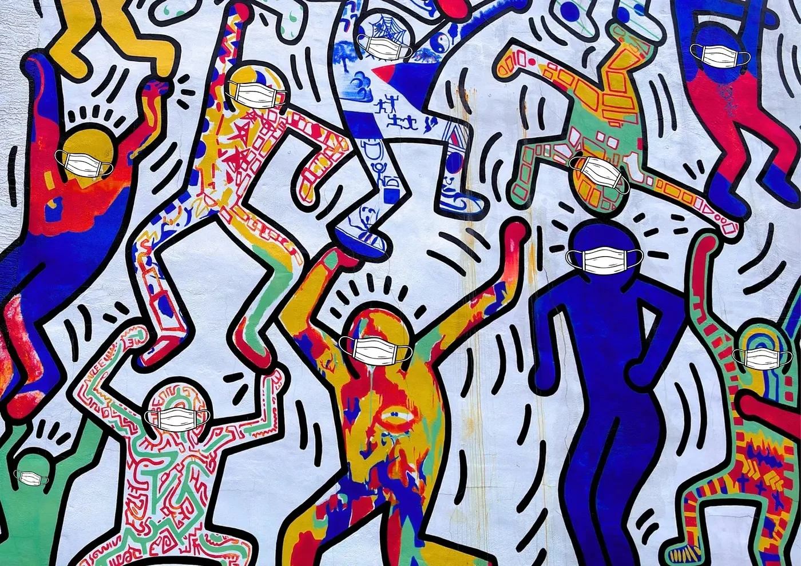

[Read this post on Medium](https://medium.com/science-policy-in-a-snap/funding-trust-and-the-next-pandemic-05bece35fb1b)

Written by SNAP Members [Doga Tasdemir](https://medium.com/@dogatasd) and [Andrew Ramirez](https://medium.com/u/dae21ae6da2b), who equally contributed to this article.

*Thoughts and views written in this blog post reflect those of the author(s) only, and not necessarily those of every SNAP member or the SNAP coalition as a whole.*

*Footnotes are denoted with superscript numbers. References are denoted with brackets.*

#### Lessons from AIDS and COVID

<figure style="margin: 1em 0; text-align: center;">

<figcaption style="margin-top: 0.5em; font-size: 0.875em; color: #6b6b6b; text-align: center; line-height: 1.4;">
Collage and photo by Doga Tasdemir. We the Youth (1987), a collaborative mural by Keith Haring and 14 high school students, his only surviving collaborative mural. It was recently registered as a <a href="https://www.inquirer.com/arts/keith-haring-mural-designation-historical-city-philadelphia-20261009.html">Historic Place </a>in Philadelphia, PA.
</figcaption>
</figure>

The AIDS epidemic and the COVID-19 pandemic follow similar arcs. Both were caused by new viruses that scientists had to understand in real time, while fear and rumors sprawled. In both, early official responses fell short, and the people with the least money and access to care were hit hardest. In each instance, the turning point to understanding and treating these diseases came from federally funded research: antiretroviral drugs for HIV and vaccines for COVID. Both have been among the world’s deadliest infectious diseases: AIDS-related illnesses have killed an estimated [44.2 million people](https://www.unaids.org/sites/default/files/2026-07/2026_UNAIDS_Global_HIV_Factsheet_en.pdf) since the epidemic began, and COVID has killed a total of [14.9 million deaths](https://www.who.int/news/item/05-05-2022-14.9-million-excess-deaths-were-associated-with-the-COVID-19-pandemic-in-2020-and-2021) in 2020 and 2021 alone. Both also left long trails: about [41 million people](https://who.int/teams/global-hiv-hepatitis-and-stis-programmes/hiv/strategic-information/hiv-data-and-statistics) were living with HIV at the end of 2025, and [over 18 million](https://www.hhs.gov/longcovid/index.html) Americans live with Long COVID [1–4].

These are not just parallel stories from our past. Both diseases are still with us, and so are the systems that drove the scientific response to them. COVID saw trust in science split along party lines, and threats to [funding forecast an increase in HIV cases](https://www.medpagetoday.com/meetingcoverage/croi/120084) [5]. In this piece, we look at how each crisis unfolded, what living with each disease looks like now, and why one response took years while the other took months.

**The end of an emergency is not the end of a disease. Our preparedness for the next pandemic depends on research funding that lasts beyond the headlines and on earned public trust.**

#### The slow burn addressing the AIDS epidemic

In the early 1980’s, scientists identified Human immunodeficiency virus type 1 ([HIV-1](https://pmc.ncbi.nlm.nih.gov/articles/PMC3234451/)) as causing progressive damage to the immune system by attacking CD4+ T cells, vital white blood cells that fight off infections [6]. A person living with HIV can develop Acquired Immune Deficiency Syndrome ([AIDS](https://hivinfo.nih.gov/understanding-hiv/fact-sheets/stages-hiv-infection)) when the disease progresses [7].

Unfortunately, the initial documentation from the CDC of [five gay men in Los Angeles](https://www.cdc.gov/museum/online/story-of-cdc/aids/index.html) resulted in the beginning of misinformation for this horrific disease [8]. Initially, the public thought that only gay males could obtain HIV. However, anyone can obtain HIV because it can be spread through blood, semen, rectal fluids, vaginal fluids, and breast milk through unprotected sex, sharing needles, pregnancy, and breastfeeding. Because the [first cases covered by the news](https://news.gallup.com/vault/259643/gallup-vault-fear-anxiety-during-1980s-aids-crisis.aspx) were primarily in gay males, HIV infections and AIDS became associated with several derogatory and scientifically incorrect terms such as the GRID (gay-related immune deficiency), gay cancer, gay plague, and 4H (homosexuals, hemophiliacs, Haitians, and heroin users) [9].

Although the first recorded patients were identified with suppressed immune systems in 1981, [President Ronald Reagan did not publicly discuss](https://www.history.com/articles/aids-epidemic-ronald-reagan) AIDS until 1985 [10]. The government was initially silent on AIDS. However, over time, several funding mechanisms, research, and awareness campaigns started to occur. [In the CDC’s immunology and virology lab](https://www.cdc.gov/museum/online/story-of-cdc/aids/index.html), scientists as a part of an international effort were among the first to begin understanding how AIDS was transmitted and what caused it [8]. Later in 1987, the CDC created a national campaign to combat disinformation and educate the public on AIDS. That campaign, [“America Responds to AIDS”](https://stacks.cdc.gov/view/cdc/49880), was followed in 1988 by [Understanding AIDS](https://stacks.cdc.gov/view/cdc/6927), a frank, eight-page pamphlet from Surgeon General C. Everett Koop that was mailed to all 107 million US households, the largest public health mailing in the country’s history [11,12]. This drew backlash: some religious conservatives objected to its plain talk about sex. Misinformation about AIDS infiltrated Food and Drug Administration (FDA) policies with regards to donating blood; the FDA officially ended its policy regarding men who sleep with men in 2023.

US research funding enabled [major strides in treatments for prevention and management](https://www.fda.gov/about-fda/fda-history-exhibits/history-fdas-role-preventing-spread-hivaids) of HIV. The FDA approved the first drug to treat HIV, Zidovudine ([AZT](https://www.webmd.com/hiv-aids/hiv-treatment-history)) in 1987 [13,14]. The next approved treatment for HIV was not until 1996, with highly active antiretroviral therapy (HAART) bringing down HIV viral loads down to an undetectable level, saving many lives. Other major milestones in the preventative space was the approval of pre-exposure prophylaxis ([PrEP](https://www.cfr.org/education/learn/timelines/changing-response-aids)) in 2012, reducing the risk of transmitting HIV down to 1% [15]. Since 2020, injectable treatments for prevention of HIV have been approved for patients, demonstrating that innovation and financial investment into research continues to provide life-changing solutions for patients.

Marginalized groups were less aware of the scientific information being produced by the CDC, preventing lives from being saved. Lower socioeconomic brackets typically lacked health insurance, resulting in late-stage detection of their infection status and lower awareness of treatment opportunities. Due to historic harms, marginalized groups were also less likely to trust medical and government authorities. This consistent lack of support led to the creation of [ACT UP](https://www.britannica.com/topic/ACT-UP), to improve awareness and information of the disease through nonviolent protesting [16]. ACT UP [organized demonstrations and protests](https://americanarchive.org/exhibits/hiv-aids-and-public-broadcasting/5-1989-1991-broadcasting-act-up-direct-action) resulted in faster drug approval, lower drug prices, and improved representation in clinical trials [17].

#### Responding to COVID-19

In late December 2019, health officials in Wuhan, China, reported a cluster of pneumonia cases with no known cause. The culprit was a new coronavirus, later named SARS-CoV-2; the illness it causes is called COVID-19. The World Health Organization (WHO) declared a global health [pandemic](https://www.cdc.gov/museum/timeline/covid19.html) on March 11, 2020 [18] The virus was already in the US by then: the CDC confirmed the first American case in Washington state on January 21, 2020.

COVID-19 spread faster than any public health crisis in living memory. Within weeks, schools, offices, and borders closed. Additionally, hospitals ran short of beds, ventilators and protective equipment. COVID-19 was the [third leading cause of death in the US in both 2020 and 2021](https://www.healio.com/news/infectious-disease/20220822/covid19-third-leading-cause-of-death-in-2020-2021), behind only heart disease and cancer [19]. The US passed [1 million recorded COVID deaths](https://wnyt.com/?p=26125) in May 2022, just 27 months after its first confirmed case [20].

Similarly with COVID, essential workers (farmers, grocery store workers, transit workers, agriculture, grocery, and healthcare workers) were the most affected and could not work from home to survive. Ethnic minorities and low-income individuals, as with the AIDS epidemic, had the [worst outcomes of COVID](https://pmc.ncbi.nlm.nih.gov/articles/PMC8586903/) [21]. These groups [more often reside](https://pmc.ncbi.nlm.nih.gov/articles/PMC9480470/) in more crowded households, travel by mass transit, and make up the essential worker group. Often COVID-infected individuals were not willing to go to the hospital because of their [insurance and income status](https://pmc.ncbi.nlm.nih.gov/articles/PMC8184063/) [22,23].

The federal government was slow to act, and its early messages were confusing and often contradictory. National leaders [repeatedly played down the threat](https://www.bmj.com/content/bmj/369/bmj.m1643.full.pdf), hospitals ran short of masks and protective gear, and the US did not declare a national emergency until March 13th, nearly eight weeks after its first confirmed case. Those lost weeks, while the virus spread largely undetected, planted early doubts about the agencies in charge, doubts that persist today. This lack of communication led to [misinformation and conspiracy theories](https://theconversation.com/misinformation-is-a-common-thread-between-the-covid-19-and-hiv-aids-pandemics-with-deadly-consequences-187968) which fueled [discrimination, xenophobia, and harassment](https://steinhardt.nyu.edu/ihdsc/on-the-ground/asian-american-experiences-racism-during-covid-19) during the COVID pandemic toward Asian Americans and Pacific Islanders (AAPIs) [24–26]. This stemmed from political scapegoating and blame surrounding where COVID originated. Racist comments from officials such as calling COVID the “Chinese virus” were large contributors to the hostility towards the AAPI community.

Eventually, the response became more rapid. Congress passed a series of emergency spending bills: the $8.3 billion [Coronavirus Preparedness and Response Supplemental Appropriations Act](https://www.congress.gov/bill/116th-congress/house-bill/6074) on March 6, 2020; the $2.2 trillion [CARES Act](https://www.congress.gov/bill/116th-congress/house-bill/748) three weeks later, which sent money to hospitals, businesses, families and public health agencies; and the [$1.9 trillion American Rescue Plan](https://www.congress.gov/bill/117th-congress/house-bill/1319) in March 2021 [27–29]. In parallel, [Operation Warp Speed](https://www.congress.gov/bill/117th-congress/senate-bill/1604), created a partnership between industry, the Department of Health and Human Services (HHS), and the Department of Defense, which funded vaccine development, manufacturing and purchasing [30]. The FDA authorized the first vaccines in December 2020.

New variants, including Delta in mid-2021 and Omicron at the end of that year, kept the pandemic going well after vaccines arrived. As immunity grew and deaths fell, the WHO ended its global emergency on [May 5, 2023](https://www.healio.com/news/infectious-disease/20230620/who-says-covid19-no-longer-a-global-public-health-emergency), and the US ended its federal public health emergency on May 11, 2023 [31]. However, COVID did not disappear. It became an ongoing illness that still causes hospitalizations and deaths every year, and it left behind a chronic condition that millions are still living with.

#### Living with Chronic Viral Infection

Neither disease ended when the emergency response did. For millions of people, the hardest part, and the part that still depends on public funding, came after the headlines moved on. Antiretroviral therapy turned HIV from a near-certain death sentence into a manageable chronic condition. That outcome depends on lifelong medication and steady care.

In 2024, the National Academies [defined Long COVID](https://www.nationalacademies.org/news/2024/06/federal-government-clinicians-employers-and-others-should-adopt-new-definition-for-long-covid-to-aid-in-consistent-diagnosis-documentation-and-treatment) as an infection-associated chronic condition lasting at least three months, affecting one or more organ systems [32]. CDC data from late 2024 found that [17.9% of US adults had experienced it and 5.3% still did](https://www.statista.com/chart/31773/us-adults-who-have-had-are-experiencing-long-covid), with higher rates among [lower-income adults](https://jamanetwork.com/journals/jamanetworkopen/fullarticle/2828033). Unlike HIV, it still has no approved treatment [33,34].

The two are linked by science and by funding. UCSF researchers [adapted decades of HIV research infrastructure](https://www.ucsf.edu/news/2026/01/431346/solving-long-covid-how-decades-hiv-research-paved-way) to launch one of the first Long COVID studies in 2020 [35]. But Long COVID funding has been stop-and-start: Congress gave NIH $1.15 billion for its RECOVER program, then [45 RECOVER studies were cancelled](https://cen.acs.org/policy/research-funding/NIH-cancels-RECOVER-grants-long/103/web/2025/03) in 2025, with HHS arguing the pandemic was over, before some were reinstated [36].

**Emergency funding ends when the emergency does; chronic illness does not. Both diseases show that the work that matters most often begins after the headlines fade.**

#### Art and Grief

As both crises took lives, survivors and loved ones used art to process grief and build community. During the AIDS epidemic, art became a way to grieve, to protest, and to insist that the people dying be seen. In 1987, the activists behind the [Silence = Death poster](https://www.brooklynmuseum.org/objects/159258), a pink triangle above those three words, handed it to the newly formed ACT UP, and it became one of the defining images of the movement [37]. Keith Haring made paintings and murals to raise awareness and money for AIDS before his own death from the disease in 1990. Musicals like *Falsettos* and *Rent* brought the epidemic to Broadway audiences. Loved ones of AIDS victims came together in making [The AIDS Memorial Quilt](https://www.aidsmemorial.org/interactive-aids-quilt) [38].

COVID art was shaped by isolation. With galleries and theaters closed, people shared drawings, photos and [posts online to process lockdown](https://www.washingtonpost.com/arts-entertainment/2020/07/06/art-pandemic-readers/), their longing for community and what the world looked like when we couldn’t be together [39]. When people could gather again, the National Mall became a memorial once more. In fall 2021, artist [Suzanne Brennan Firstenberg’s In America: Remember](https://www.suzannefirstenberg.com/in-america-remember) covered it with more than 670,000 white flags, one for each American who had died of COVID by then, and visitors could write a name on a flag for someone they had lost [40].

#### Learning from History

AIDS and COVID infected and killed millions of people, a product of the virus itself and the poor response from our government. In both cases, the turning points came from federal investment in research, and in both cases the people with the least money, power and access to care paid the highest price.

The speed of the COVID response was due to the infrastructure already built. The mRNA vaccines expanded on decades of basic research funded long before anyone had heard of SARS-CoV-2. Research that looks unrelated to today’s crisis is often what makes tomorrow’s response possible. Programs like the Ryan White CARE Act (1990) and PEPFAR (2003) show what sustained funding can do: AIDS-related deaths worldwide have [fallen 73% since their 2004 peak](https://www.unaids.org/sites/default/files/2026-07/2026_UNAIDS_Global_HIV_Factsheet_en.pdf) [4]. Both epidemics strained public trust in science. Research produces vaccines and treatments, but they only work if people are willing to use them. Now, doubts that began in 2020 have shaped our current scientific and public health landscapes. Both Republicans’ and Democrats’ confidence in scientists [fell during the pandemic](https://www.courthousenews.com/republican-trust-in-scientists-inches-up-post-pandemic/), and although overall trust has improved, the [partisan divide](https://www.pewresearch.org/science/2024/11/14/public-trust-in-scientists-and-views-on-their-role-in-policymaking/) has grown [41,42]. Measles, declared eliminated in the US in 2000, has come back: [4,410 cases were confirmed in 2026 as of mid-October](https://usafacts.org/answers/how-many-measles-cases-are-there-in-the-us/country/united-states/) [43]. Kindergarten vaccine exemptions reached a [record 4.2% in the 2025–26 school year](https://katv.com/news/nation-world/cdc-us-kindergarten-vaccine-exemptions-hit-record-high-as-coverage-falls-nationwide), and the Pan American Health Organization will decide in November 2026 [whether the US keeps its elimination status](https://www.paho.org/en/news/2-3-2026-update-review-measles-elimination-status) [44,45]. Tuberculosis, the disease that reclaimed the title of world’s deadliest infection from COVID, is rising at home too: US cases topped [10,300 in 2024, the highest since 2011](https://www.cdc.gov/tb-data/aboutprovisionaldata/2025-provisional-data.html) [46]. None of these diseases needs a scientific breakthrough. There is a highly effective measles vaccine, and TB is curable. Like AIDS and COVID, they just need steady funding and a public that trusts science.

> *The lesson of both epidemics is that diseases do not end when the headlines do. Treatments, vaccines and cures come from continued investment, from public health messaging that is honest about uncertainty, and from consideration and care for all populations affected. The next pandemic is a question of when, not if. How ready we are will depend on whether we remember what AIDS and COVID taught us.*

#### Recognition:

*[Doga Tasdemir](https://medium.com/@dogatasd) is a PhD student in Infectious Disease and Immunity at the Temple University Lewis Katz School of Medicine. Her research focuses on brain aging and inflammation due to opioid addiction and viral infection.*

*[Andrew Ramirez](https://medium.com/u/dae21ae6da2b) is an adjunct professor at The College of New Jersey and Middlesex College. He received his PhD from UCLA developing machine learning models to analyze gene expression of immune cells.*

***Special thanks to the following SNAP members who provided feedback on this article**:*

*[Sari Terrazas](https://medium.com/u/73031b32d3a3) is a molecular biology PhD candidate studying double-stranded (dsRNA) localization and dynamics in paraspeckles at UCLA.*

*[Jordan Williams](https://medium.com/u/8ddae6e53e7b) is a pharmacology PhD candidate studying how to alter the lung’s innate immune responses to better treat chronic respiratory diseases.*

#### References:

1. 14.9 million excess deaths associated with the COVID-19 pandemic in 2020 and 2021 [Internet]. [cited 2026 Nov 2]. Available from: [https://www.who.int/news/item/05-05-2022-14.9-million-excess-deaths-were-associated-with-the-COVID-19-pandemic-in-2020-and-2021](https://www.who.int/news/item/05-05-2022-14.9-million-excess-deaths-were-associated-with-the-COVID-19-pandemic-in-2020-and-2021)
2. HIV data and statistics [Internet]. [cited 2026 Nov 2]. Available from: [https://www.who.int/teams/global-hiv-hepatitis-and-stis-programmes/hiv/strategic-information/hiv-data-and-statistics](https://www.who.int/teams/global-hiv-hepatitis-and-stis-programmes/hiv/strategic-information/hiv-data-and-statistics)
3. Affairs (ASPA) AS for P. Invisible Illness: Long COVID [Landing Page] [Internet]. 2026 [cited 2026 Nov 2]. Available from: [https://www.hhs.gov/longcovid/index.html](https://www.hhs.gov/longcovid/index.html)
4. unaids.org/sites/default/files/2026–07/2026_UNAIDS_Global_HIV_Factsheet_en.pdf [Internet]. [cited 2026 Nov 2]. Available from: [https://www.unaids.org/sites/default/files/2026-07/2026_UNAIDS_Global_HIV_Factsheet_en.pdf](https://www.unaids.org/sites/default/files/2026-07/2026_UNAIDS_Global_HIV_Factsheet_en.pdf)
5. Study Warns of Large Increase in New HIV Cases in U.S. if Ryan White Program Ends \| MedPage Today [Internet]. [cited 2026 Nov 2]. Available from: [https://www.medpagetoday.com/meetingcoverage/croi/120084](https://www.medpagetoday.com/meetingcoverage/croi/120084)
6. Sharp PM, Hahn BH. Origins of HIV and the AIDS Pandemic. Cold Spring Harb Perspect Med. 2011 Sep;1(1):a006841. [doi:10.1101/cshperspect.a006841](https://doi.org/10.1101/cshperspect.a006841) PubMed PMID: 22229120; PubMed Central PMCID: PMC3234451.
7. The Stages of HIV Infection \| NIH [Internet]. [cited 2026 Nov 2]. Available from: [https://hivinfo.nih.gov/understanding-hiv/fact-sheets/stages-hiv-infection](https://hivinfo.nih.gov/understanding-hiv/fact-sheets/stages-hiv-infection)
8. The AIDS Epidemic in the United States, 1981-early 1990s \| David J. Sencer CDC Museum \| CDC [Internet]. 2025 [cited 2026 Nov 2]. Available from: [https://www.cdc.gov/museum/online/story-of-cdc/aids/index.html](https://www.cdc.gov/museum/online/story-of-cdc/aids/index.html)
9. Inc G. Gallup.com [Internet]. 2019 [cited 2026 Nov 2]. Gallup Vault: Fear and Anxiety During the 1980s AIDS Crisis. Available from: [https://news.gallup.com/vault/259643/gallup-vault-fear-anxiety-during-1980s-aids-crisis.aspx](https://news.gallup.com/vault/259643/gallup-vault-fear-anxiety-during-1980s-aids-crisis.aspx)
10. Bennington-Castro J. HISTORY [Internet]. 2020 [cited 2026 Nov 2]. How AIDS Remained an Unspoken — But Deadly — Epidemic for Years. Available from: [https://www.history.com/articles/aids-epidemic-ronald-reagan](https://www.history.com/articles/aids-epidemic-ronald-reagan)
11. America Responds to AIDS [logo] [Internet]. [cited 2026 Nov 2]. Available from: [https://stacks.cdc.gov/view/cdc/49880](https://stacks.cdc.gov/view/cdc/49880)
12. United States PHSO of the SG, Control (U.S.) C for D. Understanding AIDS [1988] [Internet]. Centers for Disease Control and Prevention (U.S.); 1988 [cited 2026 Nov 2]. Available from: [https://stacks.cdc.gov](https://stacks.cdc.gov/view/cdc/6927)
13. The History of FDA’s Role in Preventing the Spread of HIV/AIDS \| FDA [Internet]. [cited 2026 Nov 2]. Available from: [https://www.fda.gov/about-fda/fda-history-exhibits/history-fdas-role-preventing-spread-hivaids](https://www.fda.gov/about-fda/fda-history-exhibits/history-fdas-role-preventing-spread-hivaids)
14. WebMD [Internet]. [cited 2026 Nov 2]. The History of HIV Treatment: Antiretroviral Therapy and More. Available from: [https://www.webmd.com/hiv-aids/hiv-treatment-history](https://www.webmd.com/hiv-aids/hiv-treatment-history)
15. How the World Responded to AIDS \| CFR Education [Internet]. 2025 [cited 2026 Nov 2]. Available from: [https://www.cfr.org/education/learn/timelines/changing-response-aids](https://www.cfr.org/education/learn/timelines/changing-response-aids)
16. ACT UP \| International AIDS Activism & Protest Movement \| Britannica [Internet]. [cited 2026 Nov 2]. Available from: [https://www.britannica.com/topic/ACT-UP](https://www.britannica.com/topic/ACT-UP)
17. 1989–1991: Broadcasting ACT UP Direct Action \| American Archive of Public Broadcasting [Internet]. [cited 2026 Nov 2]. Available from: [https://americanarchive.org/exhibits/hiv-aids-and-public-broadcasting/5-1989-1991-broadcasting-act-up-direct-action](https://americanarchive.org/exhibits/hiv-aids-and-public-broadcasting/5-1989-1991-broadcasting-act-up-direct-action)
18. CDC. Centers for Disease Control and Prevention [Internet]. 2024 [cited 2026 Nov 2]. CDC Museum COVID-19 Timeline. Available from: [https://www.cdc.gov/museum/timeline/covid19.html](https://www.cdc.gov/museum/timeline/covid19.html)
19. COVID-19 third leading cause of death in 2020, 2021 [Internet]. [cited 2026 Nov 2]. Available from: [https://www.healio.com/news/infectious-disease/20220822/covid19-third-leading-cause-of-death-in-2020-2021](https://www.healio.com/news/infectious-disease/20220822/covid19-third-leading-cause-of-death-in-2020-2021)
20. June 10 NNU, May 4 2022–12:09 AMPublished:, Pm 2022–7:34. NBC News: United States surpasses 1 million COVID deaths. WNYT.com NewsChannel 13 [Internet]. 2022 May 4 [cited 2026 Nov 2]. Available from: [https://wnyt.com/archive/nbc-news-united-states-surpasses-1-million-covid-deaths/](https://wnyt.com/archive/nbc-news-united-states-surpasses-1-million-covid-deaths/)
21. Magesh S, John D, Li WT, Li Y, Mattingly-app A, Jain S, et al. Disparities in COVID-19 Outcomes by Race, Ethnicity, and Socioeconomic Status. JAMA Netw Open. 2021 Nov 11;4(11):e2134147. [doi:10.1001/jamanetworkopen.2021.34147](https://doi.org/10.1001/jamanetworkopen.2021.34147) PubMed PMID: 34762110; PubMed Central PMCID: PMC8586903.
22. Lau DT, Sosa P. Disparate Impact of the COVID-19 Pandemic and Health Equity Data Gaps. Am J Public Health. 2022 Oct;112(10):1404–6. [doi:10.2105/AJPH.2022.307052](https://doi.org/10.2105/AJPH.2022.307052) PubMed PMID: 36103692; PubMed Central PMCID: PMC9480470.
23. Dawa N, Narain JP. COVID-19 & HIV/AIDS pandemics: Parallels & lessons. Indian J Med Res. 2021;153(1–2):214–8. [doi:10.4103/ijmr.IJMR_2598_20](https://doi.org/10.4103/ijmr.IJMR_2598_20) PubMed PMID: 33818479; PubMed Central PMCID: PMC8184063.
24. Apetrei C. The Conversation [Internet]. 2022 [cited 2026 Nov 2]. Misinformation is a common thread between the COVID-19 and HIV/AIDS pandemics — with deadly consequences. Available from: [https://theconversation.com/misinformation-is-a-common-thread-between-the-covid-19-and-hiv-aids-pandemics-with-deadly-consequences-187968](https://theconversation.com/misinformation-is-a-common-thread-between-the-covid-19-and-hiv-aids-pandemics-with-deadly-consequences-187968) [doi:10.64628/AAI.rvptm4e6j](https://doi.org/10.64628/AAI.rvptm4e6j)
25. Asian American Experiences of Racism during COVID-19 \| NYU Steinhardt [Internet]. [cited 2026 Nov 2]. Available from: [https://steinhardt.nyu.edu/ihdsc/on-the-ground/asian-american-experiences-racism-during-covid-19](https://steinhardt.nyu.edu/ihdsc/on-the-ground/asian-american-experiences-racism-during-covid-19)
26. Yamey G, Gonsalves G. Donald Trump: a political determinant of covid-19. BMJ. 2020 Apr 24;369:m1643. [doi:10.1136/bmj.m1643](https://doi.org/10.1136/bmj.m1643) PubMed PMID: 32332028.
27. Rep. Courtney J [D C 2. H.R.748–116th Congress (2019–2020): CARES Act [legislation] [Internet]. 2020 [cited 2026 Nov 2]. Located at: 2019–01–24. Available from: [https://www.congress.gov/bill/116th-congress/house-bill/748](https://www.congress.gov/bill/116th-congress/house-bill/748)
28. Rep. Yarmuth JA [D K 3. H.R.1319–117th Congress (2021–2022): American Rescue Plan Act of 2021 [legislation] [Internet]. 2021 [cited 2026 Nov 2]. Located at: 2021–02–24. Available from: [https://www.congress.gov/bill/117th-congress/house-bill/1319](https://www.congress.gov/bill/117th-congress/house-bill/1319)
29. Rep. Lowey NM [D N 17. H.R.6074–116th Congress (2019–2020): Coronavirus Preparedness and Response Supplemental Appropriations Act, 2020 [legislation] [Internet]. 2020 [cited 2026 Nov 2]. Located at: 2020–03–04. Available from: [https://www.congress.gov/bill/116th-congress/house-bill/6074](https://www.congress.gov/bill/116th-congress/house-bill/6074)
30. Sen. Cotton T [R A. S.1604–117th Congress (2021–2022): Operation Warp Speed Act of 2021 [legislation] [Internet]. 2021 [cited 2026 Nov 2]. Located at: 2021–05–13. Available from: [https://www.congress.gov/bill/117th-congress/senate-bill/1604](https://www.congress.gov/bill/117th-congress/senate-bill/1604)
31. WHO says COVID-19 no longer a global public health emergency [Internet]. [cited 2026 Nov 2]. Available from: [https://www.healio.com/news/infectious-disease/20230620/who-says-covid19-no-longer-a-global-public-health-emergency](https://www.healio.com/news/infectious-disease/20230620/who-says-covid19-no-longer-a-global-public-health-emergency)
32. Federal Government, Clinicians, Employers, and Others Should Adopt New Definition for Long COVID to Aid in Consistent Diagnosis, Documentation, and Treatment [Internet]. [cited 2026 Nov 2]. Available from: [https://www.nationalacademies.org/news/federal-government-clinicians-employers-and-others-should-adopt-new-definition-for-long-covid-to-aid-in-consistent-diagnosis-documentation-and-treatment](https://www.nationalacademies.org/news/federal-government-clinicians-employers-and-others-should-adopt-new-definition-for-long-covid-to-aid-in-consistent-diagnosis-documentation-and-treatment)
33. Vahratian A, Saydah S, Bertolli J, Unger ER, Gregory CO. Prevalence of Post–COVID-19 Condition and Activity-Limiting Post–COVID-19 Condition Among Adults. JAMA Netw Open. 2024 Dec 13;7(12):e2451151. [doi:10.1001/jamanetworkopen.2024.51151](https://doi.org/10.1001/jamanetworkopen.2024.51151)
34. Fleck A. Statista Daily Data [Internet]. 2025 [cited 2026 Nov 2]. Infographic: Long Covid Continues to Affect Americans. Available from: [https://www.statista.com/chart/31773/us-adults-who-have-had-are-experiencing-long-covid](https://www.statista.com/chart/31773/us-adults-who-have-had-are-experiencing-long-covid)
35. Solving Long COVID: How Decades of HIV Research Paved the Way \| UC San Francisco [Internet]. 2026 [cited 2026 Nov 2]. Available from: [https://www.ucsf.edu/news/2026/01/431346/solving-long-covid-how-decades-hiv-research-paved-way](https://www.ucsf.edu/news/2026/01/431346/solving-long-covid-how-decades-hiv-research-paved-way)
36. Chemical & Engineering News [Internet]. 2025 [cited 2026 Nov 2]. NIH cancels grants through flagship long COVID initiative. Available from: [https://cen.acs.org/policy/research-funding/NIH-cancels-RECOVER-grants-long/103/web/2025/03](https://cen.acs.org/policy/research-funding/NIH-cancels-RECOVER-grants-long/103/web/2025/03)
37. Brooklyn Museum [Internet]. [cited 2026 Nov 2]. SILENCE=DEATH. Available from: [https://www.brooklynmuseum.org/objects/159258](https://www.brooklynmuseum.org/objects/159258)
38. Interactive AIDS Quilt [Internet]. [cited 2026 Nov 2]. Available from: [https://www.aidsmemorial.org/interactive-aids-quilt](https://www.aidsmemorial.org/interactive-aids-quilt)
39. Washington Post [Internet]. [cited 2026 Nov 2]. The best pandemic art created by Post readers, from a stimulus-check mask to a chicken-recipe sculpture. Available from: [https://www.washingtonpost.com/arts-entertainment/2020/07/06/art-pandemic-readers/](https://www.washingtonpost.com/arts-entertainment/2020/07/06/art-pandemic-readers/)
40. Suzanne Brennan Firstenberg [Internet]. [cited 2026 Nov 2]. In America: Remember.: Installation by Suzanne Brennan Firstenberg honoring those lost to COVID-19. Available from: [https://www.suzannefirstenberg.com/in-america-remember](https://www.suzannefirstenberg.com/in-america-remember)
41. Americans’ trust in scientists in 2024 \| Pew Research Center [Internet]. [cited 2026 Nov 2]. Available from: [https://www.pewresearch.org/science/2024/11/14/public-trust-in-scientists-and-views-on-their-role-in-policymaking/](https://www.pewresearch.org/science/2024/11/14/public-trust-in-scientists-and-views-on-their-role-in-policymaking/)
42. Jones A. Republican trust in scientists inches up, post-pandemic. Courthouse News Service [Internet]. 2024 Nov 14 [cited 2026 Nov 2]. Available from: [https://www.courthousenews.com/republican-trust-in-scientists-inches-up-post-pandemic](https://www.courthousenews.com/republican-trust-in-scientists-inches-up-post-pandemic)
43. USAFacts [Internet]. 2026 [cited 2026 Nov 2]. How many measles cases are there in the US? Available from: [https://usafacts.org/answers/how-many-measles-cases-are-there-in-the-us/country/united-states/](https://usafacts.org/answers/how-many-measles-cases-are-there-in-the-us/country/united-states/)
44. Update on the review of measles elimination status — PAHO/WHO \| Pan American Health Organization [Internet]. 2026 [cited 2026 Nov 2]. Available from: [https://www.paho.org/en/news/2-3-2026-update-review-measles-elimination-status](https://www.paho.org/en/news/2-3-2026-update-review-measles-elimination-status)
45. Desk EK\| TNN. KATV [Internet]. 2026 [cited 2026 Nov 2]. CDC: U.S. kindergarten vaccine exemptions hit record high as coverage falls nationwide. Available from: [https://katv.com/news/nation-world/cdc-us-kindergarten-vaccine-exemptions-hit-record-high-as-coverage-falls-nationwide](https://katv.com/news/nation-world/cdc-us-kindergarten-vaccine-exemptions-hit-record-high-as-coverage-falls-nationwide)
46. Provisional 2025 Tuberculosis Data, United States \| Tuberculosis Data \| CDC [Internet]. [cited 2026 Nov 2]. Available from: [https://www.cdc.gov/tb-data/aboutprovisionaldata/2025-provisional-data.html](https://www.cdc.gov/tb-data/aboutprovisionaldata/2025-provisional-data.html)
