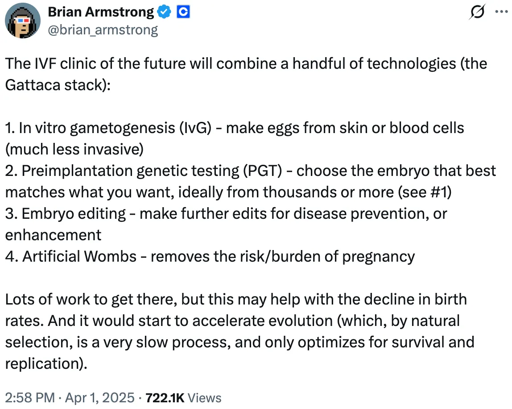

[Read this post on Medium](https://medium.com/science-policy-in-a-snap/wombs-wealth-and-worth-exploring-the-ethical-implications-of-reproductive-technologies-edc6ea05e03f)

Written by SNAP members [Sneha Rao](https://medium.com/@sneharao_56428) and [Celine Tsoi](https://medium.com/@celinetsoi), who contributed equally to this article.

*References for further reading are included at the end.*

<figure style="margin: 1em 0; text-align: center;">

<figcaption style="margin-top: 0.5em; font-size: 0.875em; color: #6b6b6b; text-align: center; line-height: 1.4;">
Image created with open-source graphics by Sneha Rao. The embryo shown in the figure is a mouse embryo imaged by Sneha Rao at UCSF and styled to match the figure.
</figcaption>
</figure>

Imagine a world where skin cells can be turned into eggs or sperm. Where a breakup leaves you fighting in court for control over your own embryos. Where your baby has DNA from three people, not two.

Is this science fiction or reality? While these scenes could be from an episode of [*The X-Files*](https://www.kqed.org/futureofyou/117571/how-crispr-made-it-onto-the-x-files), each of these scenarios represents real headlines from the last decade. Starting in the late 1800s, when an artificial insemination marked the [first recorded assisted conception](https://pmc.ncbi.nlm.nih.gov/articles/PMC4498171/), humans have been developing assisted reproductive technologies to help conceive and give birth. As the reproductive possibilities expanded, we’ve gained unprecedented control over our genetic material. For some, new reproductive technologies are a miracle, bestowing agency in a world shaped by biological lottery; for others, the potentially disastrous consequences of this brave new world are still unfolding. Despite the rapid commercialization of reproductive technologies into a [$37.7 billion industry](https://pubmed.ncbi.nlm.nih.gov/40932650/) by 2027, we are ill-equipped to navigate the social, ethical, and legal challenges raised by the emerging technologies.

Though the above headlines seem dystopian, one can imagine a future where such technologies become much more commonplace. In fact, Brian Armstrong, CEO of Coinbase, has suggested a suite of reproductive technologies that resembles a modern-day [Gattaca](https://www.imdb.com/title/tt0119177/):

<figure style="margin: 1em 0; text-align: center;">

</figure>

While we’re not endorsing Armstrong or his views of reproductive care, his “Gattaca stack” can be reframed into four categories that map the landscape of assisted reproductive technologies today: 1. In vitro (in a dish) technologies, 2. Embryo selection, 3. Embryo editing, 4. Gestational carriers.

Let’s take a deeper dive into these technologies. For each category, we’ll discuss traditional and emerging technologies and explore some of the ethical challenges we have to consider as these frontier technologies advance.

#### The landscape of assisted reproductive technologies

#### *1. In vitro technologies*

In vitro technologies handle gametes (egg and sperm cells) and embryos outside the body.

Traditional technologies include egg and sperm donation, intrauterine insemination (IUI), and in vitro fertilization (IVF). **IUI** is a non-surgical procedure where **sperm is placed in the uterus** and fertilization occurs naturally. **IVF** is a more invasive and costly procedure, where **eggs are surgically retrieved** after ovarian stimulation and fertilized by sperm injection, the subsequent embryos develop in an incubator for a few days, and healthy embryos are then either transferred into the uterus, frozen for future attempts, or donated for use in research.

Emerging technologies include in vitro gametogenesis (IVG) and stem cell-based embryo models. **IVG is the creation of gametes**, or egg and sperm cells, **from somatic cells** such as skin cells. A big breakthrough in the field was published in 2023 showing the [generation of mice with 2 biological fathers](https://www.nature.com/articles/d41586-023-03922-6). However, this process still has low efficiency and has proven challenging to accomplish with human cells, as we do not yet understand the process of egg and sperm development well enough to create functional human gametes. However, biotech start-ups like [Conception](https://www.conception.bio/) and [Vitra Labs](https://www.vitra.bio/) have also taken up this research challenge and the field could move into clinical trials within the next decade.

**Stem cell-based embryo models**, as their name suggests, use stem cells to generate different cell types present in embryos that self-organize and **mimic aspects of early embryo development without using egg or sperm.** Depending on what cell types are used to build the embryo model, they can be used to better understand different developmental stages and processes such as axis formation and early organ development. A few years ago, labs in [Israel](https://www.nature.com/articles/s41586-023-06604-5) and [California](https://www.nature.com/articles/s41586-023-06368-y) published breakthroughs where they created model of post-implantation human embryos from human stem cells for the first time. Currently, researchers are not trying to build these human stem cell-based embryo models to replace embryo development and gestation outside the body; given how much we still do not understand about the 40 weeks of fetal development, the feasibility of doing so is incredibly far-off, if not impossible. However, some researchers in the field do aim to develop these embryo models to potentially grow cells and organs [for transplants and regenerative medicine](https://pmc.ncbi.nlm.nih.gov/articles/PMC11239105/).

#### *2. Embryo selection*

Embryo selection determines which embryo gets transferred into the uterus, out of potentially several that are generated during the IVF process.

Traditional methods of selection include visual scoring and preimplantation genetic testing (PGT). **In visual scoring, a clinical embryologist [grades each embryo](https://www.asrm.org/asrm-academy/asrm-academy-on-the-go/embryo-data-grading--evaluation/grading-scales/)** under the microscope based on parameters such as embryo shape, cell number, and developmental stage, then predicts which embryos are most likely to implant successfully. However, even experienced embryologists cannot always tell if an embryo will implant even if it looks healthy by eye; as such, average implantation success rates are still lower than 50%. **PGT tests DNA** to determine sex, mutations, and chromosomal abnormalities by sampling a biopsy from the outer layer of the embryo. However, corrective mechanisms in the embryo often push cells with chromosomal abnormalities to the outer layer, since these cells contribute to the placenta (not the fetus) and can tolerate genetic irregularities without necessarily indicating an unhealthy embryo. As such, this test is [not strongly correlated to implantation success rates](https://pmc.ncbi.nlm.nih.gov/articles/PMC8607878/), yet is widely sold as an extra add-on to the IVF process.

Emerging technologies include polygenic embryo screening (PGT-P). Instead of testing for a single disease-causing gene, **PGT-P combines many small genetic variants into a “polygenic risk score”**, or a probabilistic prediction of disease risk. Though PGT-P currently cannot determine complex traits like height or intelligence that are influenced by many genes and environmental factors, some companies such as [Nucleus Genomics](https://mynucleus.com/ivf) and [Herasight](https://www.herasight.com/) are already selling this test for tens of thousands of dollars to parents who want to select IVF embryos with “enhanced” traits.

#### *3. Embryo editing*

Embryo or germline editing directly alters the genetic composition of an embryo. These in vitro technologies are all still emerging.

**Mitochondrial replacement therapy (MRT)** aims to prevent mitochondrial diseases, which pass from mother to child through the mitochondria in the egg. In this process, **nuclear DNA is moved from the mother’s egg into a donor egg** whose own nuclear DNA has been removed. Since the embryo carries nuclear DNA from both parents and a tiny amount of mitochondrial DNA from the donor, MRT is sometimes called “three-parent IVF.” Currently, this procedure is banned in the US along with other human embryo editing technologies as part of a 2015 Congressional amendment, but many researchers are [pushing to remove the ban on MRT](https://www.statnews.com/2019/04/16/mitochondrial-replacement-three-parent-ivf-ban/) to allow women with mitochondrial disease to be able to have biologically related children, and the National Academies found that clinical investigations could be [ethically permissible](https://www.nationalacademies.org/news/clinical-investigations-of-mitochondrial-replacement-techniques-are-ethically-permissible-if-significant-conditions-are-met-says-new-report) if significant conditions are met.

**Germline editing uses tools like CRISPR to cut and paste the DNA** of a gamete or embryo so the change is passed on to all future generations, not just in one individual. CRISPR technology has revolutionized cell therapies, but remain inefficient and imprecise for many disease applications. Newer versions such as base editing can swap single DNA letters without cutting both strands of DNA, making edits more precise. The international scientific community has called for a [moratorium on human germline editing](https://www.asgct.org/advocacy/policy-statements/international-call-for-a-10-year-moratorium-on-heritable-human-genome-editing-a-multi-stakeholder-initiative-to-ensure-safe-and-responsible-use-of-genetic-technologies-may-2025), and research in this area has mostly stayed pre-clinical, with one notorious exception.

In 2018, Chinese scientist He Jiankui [announced](https://www.youtube.com/watch?v=th0vnOmFltc) the birth of twin girls whose embryos he had edited to disable a gene that HIV uses to enter immune cells in an attempt to make them resistant to HIV. This gene edit was medically unnecessary, since well-established methods could already prevent transmission of HIV from the twins’ father. The editing also did not work as intended; instead of recreating the natural, protective mutation in the gene of interest, He introduced new, untested mutations, and at least one twin carried a mix of edited and unedited cells. The twins will have to be monitored for any long-term or off-target effects from the gene editing.

#### *4. Gestational carriers*

Gestational carriers are the people (or machines) that carry the developing fetus.

Traditional processes include surrogacy and incubators for premature babies. **In surrogacy, an embryo generated through IVF is transferred into the uterus** of a woman who is not genetically related to the baby. **Neonatal incubators provide a warm and monitored environment** to support premature babies after birth, though babies born more than a few weeks premature can still face serious health risks.

Emerging technologies include lab systems that support early post-implantation embryos, artificial wombs that support fetal development, and uterus transplants. Currently, guidelines restrict lab culture of embryos past 14 days of development, which is several days after the implantation stage. Researchers are developing systems to model the uterus to watch how embryos implant and support development of stem cell-based embryo models during the post-implantation period, including [rotating bottle culture](https://www.nature.com/articles/s41586-021-03416-3), [endometrial scaffolds](https://www.cell.com/cell/fulltext/S0092-8674(25)01232-2), and a “[uterus on a chip](https://www.cell.com/cell-stem-cell/fulltext/S1934-5909(25)00436-9)”. **Artificial wombs for babies aim to support extremely premature infants in a fluid-filled environment that mimics the uterus**. A “biobag” artificial womb is being developed with [sheep and pigs](https://www.npr.org/sections/health-shots/2024/04/12/1241895501/artificial-womb-premature-birth) with the goal of eventually optimizing for human clinical trials. [Colossal](https://colossal.com/), the company that is trying to bring back extinct animals, has built an [artificial womb for marsupials](https://www.rollingstone.com/culture/culture-features/colossal-artificial-womb-1235559634/) and is working towards supporting a mammal’s gestation fully outside the body. Uterus transplants let people born without a functioning uterus, or those who have had to remove their uterus, [carry their own pregnancy](https://jamanetwork.com/journals/jama/fullarticle/2848619).

#### Ethical challenges

Across all four categories, similar ethical problems highlight gaps in our socioeconomic and legal infrastructure.

#### *Cost and access*

In the US, IVF is still [expensive](https://www.uhc.com/health-and-wellness/health-topics/family-building/fertility-treatments). Even when eggs and sperm are available, one cycle costs $12,000 to $15,000. Donor sperm adds about $1,000, and donor eggs add $25,000 to $30,000 to the bill. Preimplantation genetic testing and polygenic embryo screening can also add several thousands of dollars to a round of IVF. You may think that your insurance will foot the bill. If so, consider yourself lucky — only 15 states and D.C. mandate IVF coverage, and generally do not cover many additional tests. This highlights the **existing socioeconomic disparities in the US healthcare system**, where the wealthy get more and better care than the poor. It also means that wealthy people, including some with a eugenic bent, can have many children through IVF.

#### *Race and eugenics*

Class is intertwined with race, and the reproductive industry is no exception. Egg donors deemed “[elite](https://eggdonors4all.com/elite-physician-indian-egg-donors)” (highly educated, attractive, creatively talented, etc.) are paid much more than others. Donors from some underrepresented ethnic backgrounds are also paid more for their “rarer” gametes, but unevenly. Asian donors’ eggs can fetch up to $100,000, while Black and Hispanic donors’ [top out at around $21,000](https://www.geneticsandsociety.org/biopolitical-times/how-much-do-human-eggs-really-cost).

White eggs are highly sought after too, even by non-White clients. The father of figure skater Alysa Liu, who is East Asian himself, [sought White egg donors](https://www.iflg.net/u-s-olympic-skater-born-through-assisted-reproduction/). Parents who make this choice often believe mixed-race children with White heritage benefit from a diverse gene pool, despite scarce evidence. Some countries prohibit cross-race egg donation; clinicians in these countries choose a phenotypic match for the intended mother, whereas in the US, intended parents operate in a [consumer-choice market](https://anthrosource.onlinelibrary.wiley.com/doi/pdfdirect/10.1111/maq.12767) and can choose any donor they want.

Furthermore, polygenic embryo screening are being sought after by people who want to select for “enhanced” traits in their children, such as specific eye or hair color, physique, and intelligence. This is done despite the fact that this technique cannot accurately determine complex traits.

These patterns from IVF and embryo-editing technologies imply that some traits are more desirable than others. While some of these traits seem “harmless”, such as eye and hair color, and others seem more overtly rooted in eugenics, such as race preferences. **Where do we draw the line, if we do, of what is acceptable or not to desire and alter?** If research were to shed light on complex traits in the future and screening improved, we would have to grapple with exacerbated disparities in an already stratified society.

#### *Consent and coercion*

Like any reproductive technology, unregulated surrogacy can be abused. Base [compensation for a surrogate](https://www.get-carrot.com/blog/funding-your-gestational-carrier-journey) starts around $30,000, at least three times that of egg donors. **The huge price tag increases the likelihood of financial coercion.** A woman who needs the money is much more likely to agree to be a surrogate, compromising the consent process.

Recently, a couple in Los Angeles was found to have had [dozens of children via surrogacy](https://www.newyorker.com/magazine/2026/02/16/the-babies-kept-in-a-mysterious-los-angeles-mansion). The father reportedly came to the US to have as many children as he could, because the surrogacy industry here is so unregulated. The mother posed as a single woman struggling to conceive, manipulating surrogates into carrying children for the couple. The children themselves were also found to be abused, and the couple was sentenced to prison on abuse charges. **Nothing in the system stops people like them from exploiting surrogacy again.**

#### *The unknown health risks*

Many of these technologies are reaching patients faster than we can study their long-term effects, and few safeguards exist to address risks when they arise. IVF is technically regulated at the federal level, but oversight is functionally left to individual clinics and clinicians. Most newer reproductive technologies are largely unregulated, especially in countries that attract significant medical tourism.

**Even long-established practices carry risks we have not fully studied.** Egg donors remain understudied, and some have developed [ovarian cancer and other reproductive problems](https://www.geneticsandsociety.org/biopolitical-times/how-much-do-human-eggs-really-cost) that they attribute to fertility drugs and surgeries. Repeated sperm donation creates a different kind of risk: in small communities, biological relatives can unknowingly enter a romantic relationship, resulting in inadvertent consanguinity.

Mitochondrial replacement therapy shows what happens when the promise of a technology outpaces oversight. Because MRT is effectively banned in the US for now, people travel abroad to get it, often facing false advertising, limited informed consent, and minimal oversight. Some overseas clinics market the procedure misleadingly as “[oocyte rejuvenation](https://www.nature.com/articles/d41586-026-01935-5)” for older mothers, with little to no long-term monitoring of the babies born afterward.

The stakes rise further with germline gene editing. Upgraded versions of CRISPR are making editing more efficient and accurate, but the path from cells in a dish to non-human embryos to human clinical trials is especially fraught here. An editing mistake would be carried by every generation that follows. That raises a question we are unable to answer on a personal or legal level: **who is accountable for a side effect caused by a medical decision a parent made generations earlier?**

#### *Personhood and parenthood*

Babies conceived and gestated with assisted reproductive technologies raise new questions about personhood rights. As artificial wombs are being developed for eventual use with human fetuses, the question of when life begins is reopened in an even more complex way: **what moral and legal rights does a fetus developing outside the body have and at what stage does the fetus acquire these rights?** In vitro technologies also raises similar questions. Is an embryo made from lab-grown gametes morally and legally different from an IVF or naturally conceived embryo? Do children born through IVG and IVF via donor gametes have a right to know how they were conceived and whose cells their gametes came from? And by putting genetic relatedness within reach of almost anyone, IVG could further privilege genetic ties over other paths to parenthood, like donor gametes or adoption.

Stem cell-based embryo models complicate the personhood question from the other direction. Because they are made without eggs or sperm, many rules written for embryos, including the [14-day limit](https://www.nuffieldbioethics.org/news-blog/nuffield-council-on-bioethics-begin-major-review-of-the-14-day-rule-for-research-on-human-embryos/) on growing human embryos in the lab, may not clearly apply to them. Yet, as the embryo models become more complete, it will get harder to distinguish stem cell-based models from embryos derived from fertilized eggs. **Should these stem cell-based models have the same moral and legal rights as those made with eggs and sperm?** For now, the International Society for Stem Cell Research has [stated](https://www.isscr.org/isscr-news/isscr-statement-on-new-research-with-embryo-models) that stem cell-based embryo models are not embryos and should never be transferred into a uterus. Unfortunately, guidelines like these are voluntary, and the combination of rapidly evolving science and rogue actors may make these types of guidelines obsolete.

IVG also raises a parallel set of questions about parenthood: **who legally owns these embryos?** If eggs and sperm can be made from skin cells, same-sex couples could have children genetically related to both partners, and women could have genetic children after menopause. But the same technology could be misused by turning someone’s cells into gametes without their knowledge, making them an unwitting parent. IVG could stretch our definition of family even further. In theory, one person could provide both the egg and the sperm, though the resulting embryo would carry a very high risk of serious genetic disease. Additionally, some worry that if artificial wombs become commonplace, abortion opponents could push to force pregnant women to transfer fetuses into artificial wombs instead of terminating their pregnancies, further complicating parenthood rights. Legal and social definitions of parenthood do not yet account for these specific scenarios.

#### Where do we go from here?

These cases we highlighted on IVF, embryo selection, embryo editing, and gestational carrying show that the fertility industry is a regulatory Wild West. Pandora’s box of technologies is only expanding; we can’t roll back the technology, and we can’t stop every bad actor. The real question is how to make meaningful progress in reproductive research and care with rigor and transparency, without allowing unregulated human experiments with unknown consequences.

**An honor system among scientists is not enough**, as there will always be rogue scientists and opportunists willing to exploit gaps in oversight. For example, the moratorium on heritable gene editing and guidelines for use of stem cell-based embryo models can signal where the general scientific community stands on emerging technologies, but it cannot stop someone determined to push ahead in their research.

Federal policy has not helped support our path forward. The [2015 appropriations rider](https://www.scotusblog.com/2026/08/reproductive-technologies-and-the-federal-constitutional-vacuum/) was meant to keep heritable embryo editing out of the US, but it also keeps the FDA from engaging with this research at all. That leaves the field to privately funded industry companies who can simply take their experiments and clinics abroad when US rules get in the way. “Designer baby” companies in the US are already [testing the limits of cultural gray areas](https://www.geneticsandsociety.org/biopolitical-times/silicon-valleys-race-produce-genetically-engineered-humans) with the fast-paced industry mentality. Many of these new companies such as [Origin Genomics](https://www.npr.org/2026/09/29/nx-s1-5950439/embryo-gene-editing-babies-biotech) (founded by [Cathy Tie](https://www.theguardian.com/science/2026/may/30/there-is-no-way-to-stop-this-biotech-barbie-cathy-tie-on-her-mission-to-genetically-modify-babies), He Jiankui’s ex-wife who recently [published](https://www.cell.com/trends/genetics/fulltext/S0168-9525(26)00218-0) an argument in favor of therapeutic germline editing) and [Preventive](https://www.preventive.bio/) (founded by an alumnus of one of the labs that first developed CRISPR gene editing) claim to approach the field with openness, transparency, and proper approval. Whether they can be held accountable to that in a global, largely unregulated fertility industry remains to be seen.

As researchers in academia and industry push the boundaries of what’s technically feasible, we are simultaneously entering a new frontier of ethics. However, right now we are wading through a murky lake of ethical dilemmas where we can’t see the bottom. It doesn’t have to be this way. We can, and should, grapple with the ethics of potential new technologies **before** the advancements become integrated in global clinical settings. We recommend the following approaches towards reproductive technologies moving forward.

**Engage varied communities early and often** through public engagement studies, surveys, exhibits, town halls on emerging reproductive technologies. Incorporating multiple community organizations, including religious groups, policymakers, patient advocacy groups, legal representatives, and professional scientific and medical societies will be critical to develop comprehensive regulatory infrastructure in the future. By bringing together communities with different values in honest conversations about our goals, fears, and dreams for new technologies, we can develop ethical and regulatory landmarks to build on when the science advances.

Cultures shift as people get used to new technologies, and what may seem like a science fiction dystopia today could become a mainstream process in society tomorrow. After all, IVF was once feared and rebuked by many, yet about 50 years later the technology is now fairly commonplace, with over 100,000 babies born by IVF in the US in a single year. The UK has already run [public engagement studies](https://post.parliament.uk/research-briefings/post-pn-0716/) on stem cell-based embryo models. US [polling](https://www.pewresearch.org/internet/2018/07/26/public-views-of-gene-editing-for-babies-depend-on-how-it-would-be-used/) shows that views on gene editing for babies depend heavily on how it would be used. Listening to these shifts in public sentiment will help us [prepare for legal and ethical questions](https://thereader.mitpress.mit.edu/the-future-of-family-planning-is-here-is-the-constitution-ready/) before they become reactionary emergencies.

**Set clear, enforceable standards** for research and clinical applications of reproductive technologies, and **review emerging technologies case by case**. Building on guidelines, US federal grant review should give researchers in academic and medical settings the chance to incorporate risk assessment, monitoring, and ethical review into their funding requests. Ideally, government regulations would rein in marketing and commercialization of reproductive technologies to prevent unproven add-ons and “enhancements” from being sold at high cost to hopeful parents. While federal regulation of industry is not straightforward to address, stronger standards for federally funded research can help shift cultural norms that can put pressure on industry to provide more transparent information about their services.

The US is lagging behind in engaging with the ramifications of emerging reproductive technologies, despite fostering some of the world’s leading research in the field. **We need adaptable frameworks that can keep pace with this rapidly evolving science and technology, safeguarding parents’ dreams of having their own children and protecting future children from their parents’ choices.**

#### Recognition:

*[Sneha Rao](https://medium.com/@sneharao_56428) is a leader of the Science Policy Group at UCSF and a developmental biology PhD candidate studying how cells talk to each other during embryo development. [Celine Tsoi](https://medium.com/@celinetsoi) is a PhD student in Social Psychology at UC Santa Barbara studying solidarity, social justice, and public policy with advanced statistical methods, community engagement, and open science.*

***Special thanks to the following SNAP members who provided feedback on this article**:*

*Daniel Affsprung is a PhD candidate in History and Philosophy of Science at Arizona State University. He researches the history of Congressional efforts to make science and technology more responsive to societal needs. [Maya Singh](https://medium.com/@mayasingh0606/about) is a PhD student in bioengineering at the University of Washington. Her work focuses on creating tests to measure HIV medication levels. [Sari Terrazas](https://medium.com/@sterraza95) is a molecular biology PhD candidate studying double-stranded (dsRNA) localization and dynamics in paraspeckles at UCLA.*

#### References for further reading:

1. [In vitro gametogenesis: A review of ethical and policy questions (Nuffield Council on Bioethics)](https://cdn.nuffieldbioethics.org/wp-content/uploads/NCOB-In-Vitro-Gametogenesis-Report-FINAL.pdf)
2. [Human stem cell-based embryo models: A review of ethical and governance questions (Nuffield Council on Bioethics)](https://cdn.nuffieldbioethics.org/wp-content/uploads/NCOB-SCBEM-Full-Report-Final.pdf)
3. [Embryo Law and Ethics (The Petrie-Flom Center)](https://petrieflom.law.harvard.edu/events/details/2026-annual-conference-embryo-law-and-ethics/)
4. [Mitochondrial Replacement Therapy: Considering the Future of U.S. Policy on “Three-Parent IVF” (The Petrie-Flom Center)](https://petrieflom.law.harvard.edu/events/details/mitochondrial-replacement-therapy/)
5. [Disparities in access to effective treatment for infertility in the United States (The Ethics Committee of the American Society for Reproductive Medicine)](https://www.asrm.org/globalassets/_asrm/practice-guidance/ethics-opinions/pdf/disparities_in_access_to_effective_treatment_for_infertility_in_the_us-pdfmembers.pdf)
6. [Expert Advisory Committee on Developing Global Standards for Governance and Oversight of Human Genome Editing (World Health Organization)](https://www.who.int/groups/expert-advisory-committee-on-developing-global-standards-for-governance-and-oversight-of-human-genome-editing)
7. [Women travel thousands of miles for a reproductive moonshot. Scientists say they’ve been misled (STAT Investigation)](https://www.statnews.com/2026/11/02/three-parent-ivf-fertility-tourism-investigation-mrt-therapy/)
