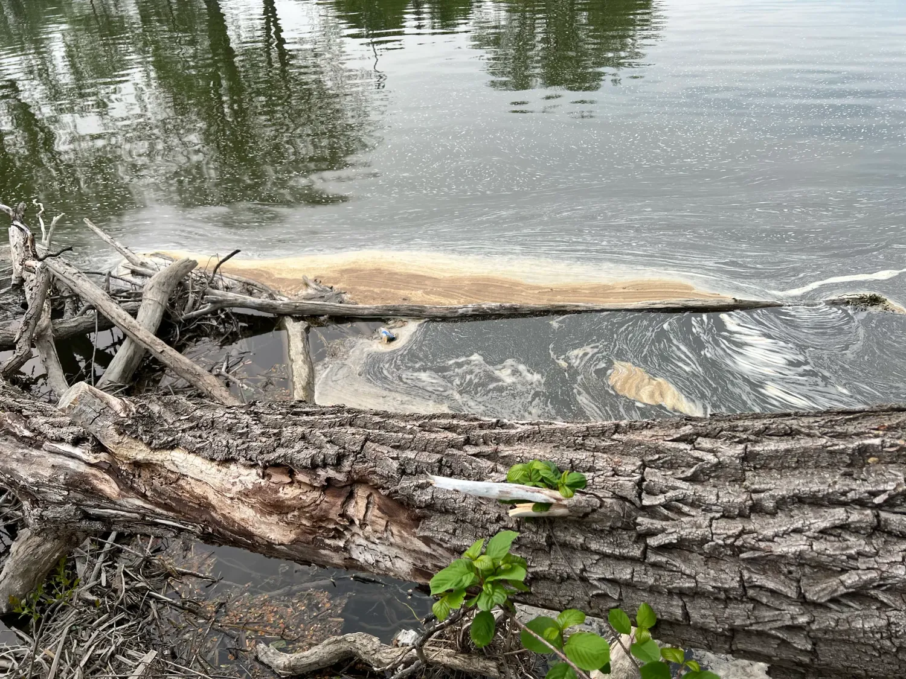
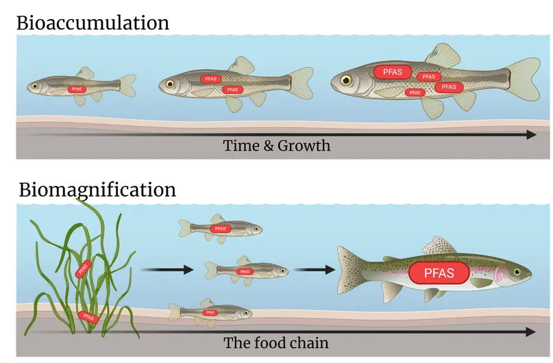

[Read this post on Medium](https://medium.com/science-policy-in-a-snap/from-trout-to-tap-pfas-is-a-policy-problem-not-a-personal-one-6658016e4bf0)

Written by SNAP members [Aislinn Gilmour](https://medium.com/@aislinn.gilmour) and [Emily Selland, PhD](https://medium.com/@eselland). Both authors contributed equally to this post.

*Thoughts and views written in this blog post reflect those of the authors only, and not necessarily those of every SNAP member or the SNAP coalition as a whole.*

*Footnotes are denoted with superscript numbers. References are denoted with brackets.*

Move over diamonds, the modern “forever” fixture in our lives are per- and polyfluoroalkyl substances (broadly referred to as PFAS). Synthetic chemicals in this large group are used in consumer and industrial products, are notoriously difficult to break down, and are found just about everywhere in the world. Indeed, the Centers for Disease Control and Prevention (CDC) reports that nearly all people in the United States have PFAS in their blood [1]. Despite impressive lists of the negative human health effects of PFAS [2], our U.S. federal policies have struggled to protect Americans from this ubiquitous chemical.

<figure style="margin: 1em 0; text-align: center;">

<figcaption style="margin-top: 0.5em; font-size: 0.875em; color: #6b6b6b; text-align: center; line-height: 1.4;">
<b>Figure 1</b>. “PFAS pollution along the Huron River in southeast Michigan, USA.” Sourced from wikimedia commons, author MountainFae, <a href="https://commons.wikimedia.org/wiki/File:PFAS_pollution_along_Huron_River.png">https://commons.wikimedia.org/wiki/File:PFAS_pollution_along_Huron_River.png</a>
</figcaption>
</figure>

The health implications of PFAS in people are concerning. The National Institute of Environmental Health Sciences reports that PFAS have been linked with:

- Altered metabolism and weight regulation, which can increase risks of obesity
- Increased risk of several cancers
- Weakened immune systems, challenging our ability to fight infections [3]

This is not a comprehensive list, and many other health effects are currently being researched.

#### But what does this have to do with fish?

PFAS don’t break down naturally in the environments they are found in: from our soil to the air we breathe and the water that we (and fish) swim in. This ubiquitous nature is partly why so many people have PFAS in their blood. Common pathways of human exposure include food and food packaging, personal care products, household products and dust, fire extinguishing foam, and manufacturing facilities that create products with PFAS [4]. In addition, it’s estimated that 45% of the United States’ tap water (what we drink) is contaminated with PFAS [5].

Briefly, PFAS are resistant to natural decomposition (the process of something breaking down) because of their chemical structure1, which also makes them appealing for industrial use. These chemicals persist in their environments and slowly bioaccumulate in living organisms as they eat and drink (Figure 2). The process of bioaccumulation occurs when PFAS builds up in organisms over time, increasing in concentration faster than their bodies can excrete it. Additionally, the process of biomagnification describes how the concentration of toxins, such as PFAS, increase in concentration as they move up the food chain [6].

<figure style="margin: 1em 0; text-align: center;">

<figcaption style="margin-top: 0.5em; font-size: 0.875em; color: #6b6b6b; text-align: center; line-height: 1.4;">
<b>Figure 2.</b> PFAS bioaccumulation in fish and biomagnification within the trout food chain. Created in BioRender. Selland, E. (2026) <a href="https://biorender.com/3hqj4xy">https://BioRender.com/3hqj4xy</a>
</figcaption>
</figure>

Fish, including top species for recreation and consumption like trout [7], represent just one pathway that humans can ingest PFAS and have led to some states enacting regional guidelines on consumption [8]. For example, Michigan has regional guidelines for Lake Michigan. These are updated annually, break down PFAS load by fish species, and are specific to each region of the lake [8]. Bioaccumulation of PFAS in humans would happen similarly to how it happens in fish (Figure 1). Yet, policies to prevent human exposure are limited (more on that below). The regional and state-specific guidelines for fish consumption represent a particularly data-driven form of governmental guidance that exists for PFAS, although they are guidance, not enforceable policies.

#### Protections for who?

The natural next step is to ask “what can I do about reducing my exposure and risk?” and many individuals have. We’ve seen an uptick in demand for PFAS-free products, an explosion of Reddit threads and blog posts about avoiding PFAS and buying specific PFAS-free products, and a rise in State Health Department pages addressing concerns [9–11].

But what if the better question is actually: “**what can science policy do about reducing everyone’s exposure and health risks**”? Because PFAS exposure is ubiquitous, in every community, affecting every population at once. Thus, it is best addressed by policies at a larger scale that capture exposure *everywhere*. The common advice for reducing exposure usually involves things like: “check your drinking water”, “avoid fish that lived in PFAS-contaminated water”, and “avoid certain food packaging.” Drinking water, fish, and food packaging are already subject to regulatory standards from the federal government. Thus, it would be effective and efficient for the government to monitor and ensure the safety of these things, rather than putting the onus on every regular person to implement changes to their daily lives. A **systemic issue requires a systemic change.**

#### A Brief Timeline of PFAS Policies:

This is not to suggest that PFAS policies do not already exist in the US, but they are often complex and weak. Additionally, the policies that do exist are technically and scientifically challenging to implement due to the evolving nature of our understanding of the diversity of PFAS. PFAS was first discovered in 1938, but its use didn’t become widespread commercially until the 1960s. While internal documents suggest some corporations knew about the health concerns of PFAS as early as the 1950s and 60s [12], global public concern and awareness of PFAS arose in the late 1990s [13]. Prior to the 2000s, “legacy” PFAS (older versions of the PFAS used today with similar, but distinct, chemical structures) were used substantially in industry. They are called “legacy” PFAS because they were phased out in many places by the global Stockholm Convention (read more about this [here](https://2021-2025.state.gov/key-topics-office-of-environmental-quality-and-transboundary-issues/stockholm-convention-on-persistent-organic-pollutants/)) [14]. Note that the US has not ratified the Stockholm Convention but is an observer of their meetings and working groups.

At the federal level in the US, the Environmental Protection Agency (EPA) is the most relevant agency to set PFAS policies. Under the EPA, the Toxic Substances Control Act (TSCA) governs chemicals in commerce(15), the Safe Drinking Water Act (SDWA) governs what comes out of our taps, and the Superfund law (the Comprehensive Environmental Response, Compensation, and Liability Act, also known as CERCLA) governs cleanup of environmental hazard areas2.

*Note: The term per- and polyfluoroalkyl substances (PFAS) encompasses a vast family of thousands of synthetic, man-made chemical compounds. Common specific chemicals under the PFAS family include: PFOA, PFOS, PFNA, PFHxS, GenX (HFPO-DA), PFBS, FOSA, NEtFOSA, NEtFOSAA, and NEtFOSE, but there are thousands of PFAS chemicals in existence*

> *1998*–**2002:** 3M, a prominent manufacturing company, tells the EPA that PFOS is turning up in human blood, and then voluntarily phases it out of production. The EPA follows up with rules requiring notice before anyone restarts the manufacturing of PFOS and dozens of related chemicals, all of which could be classified as a type of PFAS, but allowed exceptions for other highly specific versions [15].
>
> **2006:** After a record settlement with DuPont over PFOA3, the EPA launches a PFOA Stewardship Program under the Bush Administration, inviting eight major companies to voluntarily commit to cutting PFOA emissions and product content by 2015 [14].
>
> **2016:** EPA issues non-enforceable health advisories for PFOA and PFOS in drinking water (70 parts per trillion combined) under the Obama Administration [16].
>
> **2021:** EPA publishes a PFAS Strategic Roadmap promising an enforceable drinking water standard and a Superfund designation to clean up PFAS-polluted areas [17].
>
> **2022:** EPA replaces the 2016 advisories with interim concentration updates that are thousands of times lower: 0.004 parts per trillion for PFOA and 0.02 for PFOS, levels below what labs can reliably detect. These are still non-enforceable. The same year, EPA proposed listing PFOA and PFOS as hazardous substances under Superfund (CERCLA), and the proposal was finalized two years later [16].
>
> **April 2024:** The first legally enforceable federal PFAS drinking water limits arrive under the Biden Administration. They cover PFOA, PFOS, PFHxS, PFNA, HFPO-DA, and mixtures, with compliance required by April 2029. These limits are defined as Maximum Contaminant Levels (MCLs), and they must be met by 2029 [18]. Challenges to the rules are almost immediate (read more about [American Water Works Association, et al., v. EPA](https://www.epa.gov/system/files/documents/2024-06/awwa-v-epa-no-1188-dc-cir-filed-petition.pdf)).
>
> **June 2024 — March 2026:** The [American Water Works Association, et al., v. EPA](https://www.epa.gov/system/files/documents/2024-06/awwa-v-epa-no-1188-dc-cir-filed-petition.pdf) lawsuit is underway, with opening briefs in late 2024. A simplified core argument of the American Water Works Association (joined by industry and trade associations) is that the EPA’s regulations are costly, do not use the best available information, and take unlawful approaches. The EPA (joined by several states and environmental rules) is defending the 2024 rules. AMWA vs EPA has several pauses in the first half of 2025.
>
> **May 2025:** The EPA seems to backtrack under the Trump Administration, announcing it will delay implementation for some chemicals and will delay the implementation timeline for others. These announcements are not official changes [19].
>
> ***Sep*tember 2025:** EPA requests the court (presiding over AMWA vs EPA) throw out some (4/6) of the rules of the Biden-era regulations, following the May 2025 announcement [19].
>
> **January 2026:** The court (a D.C. Circuit Court) denies the EPA’s request [19].
>
> **May 2026:** The EPA proposed to rescind drinking water regulations for 4 PFAS chemicals. They also proposed to extend the compliance deadline for the PFOA and PFOS MCLs by two years, to 2031. Although they first announced these changes in May 2025 and attempted to go through the court under AMWA vs EPA first, May 2026 was the release of these changes through a formal process. This opens the public comment period. [19]
>
> **September 2026:** The D.C. Circuit Court hears oral arguments for AMWA vs EPA.
>
> **November 2026:** As of early November 2026, all original Biden-era limits technically remain in effect, with the ongoing lawsuit (AMWA vs EPA) and no final ruling at the federal level [19]. Two different angles are working against the April 2024 limits: 1) AMWA vs EPA and 2) the May 2026 EPA proposal to roll back the regulation.

Regulation of PFAS and other environmental toxicants is either preventative or reactive. Preventive regulation stops a chemical from entering use or release in the first place. Reactive regulation sets limits or orders cleanup after exposure has already happened or the toxin is already in the environment. For PFAS, most of what the US has in place is reactive, and much of the early action was voluntary. Yet, there have been several state-level policies that demonstrate *preventative* policies can be done [20].

#### What about cleanup technology?

The potential to “clean up” environments where PFAS exists is reactive to PFAS being there in the first place. Yet, scientific methods to destroy and remove PFAS are an area of active research, and new methods are being developed [21]. Some of the arguments against regulations of PFAS and related chemicals pertain to the challenges and financial hurdles of removing the chemicals from drinking water and other environments. EPA has issued interim guidance on PFAS destruction and disposal [22]. Destruction methods are an important piece of the global response, especially to deal with the existing concentrations our communities are faced with each day and to meet any future exposure limits. But this continues to follow the trend of reaction. These methods won’t prevent new PFAS from being created and put out into the environment.

In a race against bioaccumulation, it will likely take preventative and reactive policies for removal *and* reduction of PFAS at their sources to improve our environments, health, and communities.

#### Final Thoughts

**If exposure is everywhere, then protection has to be too. The trout can’t read an advisory, and most people don’t test the water at the kitchen sink. When the onus of exposure reduction is put on the individual, there is a greater likelihood that some people are safe, while others are not. PFAS exposure is coming from sources the government has the authority to regulate. That is why science policy is our best tool when it comes to PFAS and other synthetic chemical exposures that impact public health.**

#### Recognition:

*[Aislinn Gilmour](https://medium.com/@aislinn.gilmour) is a PhD student studying environmental epidemiology at Dartmouth, with a focus on how environmental chemicals impact maternal and child health.*

*[Emily Selland](https://medium.com/@eselland) is a Postdoctoral Fellow in the Centers for Health, Work & Environment at the University of Colorado School of Public Health studying environmental and social determinants of rural public health.*

***Special thanks to the following SNAP members who provided feedback on this article**:*

*[Andrew Ramirez](https://medium.com/u/dae21ae6da2b) is an adjunct professor at The College of New Jersey and Middlesex College. He received his PhD from UCLA developing machine learning models to analyze gene expression of immune cells.*

*[Jessa Burling](https://medium.com/@jessaburling0606) is a neuroscience PhD candidate at Dartmouth College studying the neural correlates and behavior post-trauma exposure, and how they might be changed with treatments like psychedelics and brain stimulation.*

#### Footnotes:

1. PFAS chemicals have long chains of hydrocarbons and carbon-fluoride bonds. Carbon-fluoride bonds are one of the strongest chemical bonds, which is what makes PFAS so difficult to degrade.
2. TSCA was enacted in 1976 and updated in 2016. SDWA was passed in 1974 and amended in the 80s and 90s. The Superfund law, CERCLA, was enacted in 1980, and it authorizes both short- and long-term cleanups of hazardous areas.
3. DuPont knew about the health impacts of PFOA and related chemicals but continued using and dumping the waste. This led to a civil case in West Virginia and has been reported on widely, including being turned into several films inspired by the story ([https://www.publicsource.org/pfas-lawyer-dark-waters-rob-bilott-dupont/](https://www.publicsource.org/pfas-lawyer-dark-waters-rob-bilott-dupont/))

#### References:

1. [CDC. Per- and Polyfluoroalkyl Substances (PFAS) and Your Health [Internet]. 2026 [cited 2026 Nov 17]. Human Exposure: PFAS Information for Clinicians — 2024. Available from: https://www.atsdr.cdc.gov/pfas/hcp/clinical-overview/human-exposure.html](https://www.atsdr.cdc.gov/pfas/hcp/clinical-overview/human-exposure.html)
2. [US EPA O. Our Current Understanding of the Human Health and Environmental Risks of PFAS [Overviews and Factsheets] [Internet]. 2021 [cited 2026 Nov 6]. Available from: https://www.epa.gov/pfas/our-current-understanding-human-health-and-environmental-risks-pfas](https://www.epa.gov/pfas/our-current-understanding-human-health-and-environmental-risks-pfas)
3. [National Institute of Environmental Health Sciences [Internet]. [cited 2026 Nov 6]. Perfluoroalkyl and Polyfluoroalkyl Substances (PFAS). Available from: https://www.niehs.nih.gov/health/topics/agents/pfc](https://www.niehs.nih.gov/health/topics/agents/pfc)
4. [Mashima R. Per- and Polyfluoroalkyl Substances (PFAS): History, Current Concerns, and Future Outlook. Molecules. 2025 Nov 14;30(22):4415. doi:10.3390/molecules30224415 PubMed PMID: 41302472; PubMed Central PMCID: PMC12655774.](https://doi.org/10.3390/molecules30224415)
5. [Tap water study detects PFAS ‘forever chemicals’ across the US \| U.S. Geological Survey [Internet]. 2023 [cited 2026 Nov 6]. Available from: https://www.usgs.gov/news/national-news-release/tap-water-study-detects-pfas-forever-chemicals-across-us](https://www.usgs.gov/news/national-news-release/tap-water-study-detects-pfas-forever-chemicals-across-us)
6. [Dowding P. Bioaccumulation: How Contaminants Build Up in Our Bodies and Drinking Water \| Water Pros Denver Water Softener Installation And Filtration Experts [Internet]. 2025 Oct 13 [cited 2026 Nov 6]. Available from: https://waterpros.net/bioaccumulation-of-water-contaminants/](https://waterpros.net/bioaccumulation-of-water-contaminants/)
7. [Rainbow Trout (Oncorhynchus mykiss) \| U.S. Fish & Wildlife Service [Internet]. 2026 [cited 2026 Nov 10]. Available from: https://www.fws.gov/species/rainbow-trout-oncorhynchus-mykiss](https://www.fws.gov/species/rainbow-trout-oncorhynchus-mykiss)
8. [PFAS in Fish [Internet]. [cited 2026 Nov 16]. Available from: https://www.michigan.gov/pfasresponse/fishandwildlife/fish](https://www.michigan.gov/pfasresponse/fishandwildlife/fish)
9. [Reducing your exposure to PFAS \| Colorado Department of Public Health and Environment [Internet]. [cited 2026 Nov 9]. Available from: https://cdphe.colorado.gov/pfas/health/reducing-exposure](https://cdphe.colorado.gov/pfas/health/reducing-exposure)
10. [euronews-english. Reducing PFAS exposure: 5 items to avoid and what to use instead [Reddit Post]. r/Health [Internet]. 2024 [cited 2026 Nov 9]. Available from: https://www.reddit.com/r/Health/comments/1dz5faf/reducing_pfas_exposure_5_items_to_avoid_and_what/](https://www.reddit.com/r/Health/comments/1dz5faf/reducing_pfas_exposure_5_items_to_avoid_and_what/)
11. [10 Ways to Minimize PFAS Exposure [Internet]. [cited 2026 Nov 9]. Available from: https://vibrant-wellness.com/blog/10-ways-to-minimize-pfas-exposure](https://vibrant-wellness.com/blog/10-ways-to-minimize-pfas-exposure)
12. [For decades, polluters knew PFAS chemicals were dangerous but hid risks from public \| Environmental Working Group [Internet]. 2019 [cited 2026 Nov 10]. Available from: https://www.ewg.org/research/decades-polluters-knew-pfas-chemicals-were-dangerous-hid-risks-public](https://www.ewg.org/research/decades-polluters-knew-pfas-chemicals-were-dangerous-hid-risks-public)
13. [Popkin G. Finding PFAS Wherever They’re Hiding. NIST [Internet]. 2024 Mar 28 [cited 2026 Nov 10]. Available from: https://www.nist.gov/feature-stories/finding-forever-chemicals-wherever-theyre-hiding](https://www.nist.gov/feature-stories/finding-forever-chemicals-wherever-theyre-hiding)
14. [US EPA O. Fact Sheet: 2010/2015 PFOA Stewardship Program [Collections and Lists] [Internet]. 2016 [cited 2026 Nov 6]. Available from: https://www.epa.gov/assessing-and-managing-chemicals-under-tsca/fact-sheet-20102015-pfoa-stewardship-program](https://www.epa.gov/assessing-and-managing-chemicals-under-tsca/fact-sheet-20102015-pfoa-stewardship-program)
15. [US EPA O. Risk Management for Per- and Polyfluoroalkyl Substances (PFAS) under TSCA [Overviews and Factsheets] [Internet]. 2015 [cited 2026 Nov 6]. Available from: https://www.epa.gov/assessing-and-managing-chemicals-under-tsca/risk-management-and-polyfluoroalkyl-substances-pfas](https://www.epa.gov/assessing-and-managing-chemicals-under-tsca/risk-management-and-polyfluoroalkyl-substances-pfas)
16. [vLex [Internet]. [cited 2026 Nov 6]. Overview of Pfas Regulations in the United States and What Foreign Companies and Their U.s. Subsidiaries Need to Know — part Ii. Available from: https://law-journals-books.vlex.com/vid/overview-of-pfas-regulations-1050947383](https://law-journals-books.vlex.com/vid/overview-of-pfas-regulations-1050947383)
17. [US EPA O. PFAS Strategic Roadmap: EPA’s Commitments to Action 2021–2024 [Overviews and Factsheets] [Internet]. 2021 [cited 2026 Nov 6]. Available from: https://www.epa.gov/pfas/pfas-strategic-roadmap-epas-commitments-action-2021-2024](https://www.epa.gov/pfas/pfas-strategic-roadmap-epas-commitments-action-2021-2024)
18. [US EPA O. Per- and Polyfluoroalkyl Substances (PFAS) [Reports and Assessments] [Internet]. 2021 [cited 2026 Nov 6]. Available from: https://www.epa.gov/sdwa/and-polyfluoroalkyl-substances-pfas](https://www.epa.gov/sdwa/and-polyfluoroalkyl-substances-pfas)
19. [PFAS in Drinking Water — Environmental and Energy Law Program [Internet]. [cited 2026 Nov 6]. Available from: https://eelp.law.harvard.edu/tracker/pfas-in-drinking-water/](https://eelp.law.harvard.edu/tracker/pfas-in-drinking-water/)
20. [Bergeson LL. NRDC Publishes Case Studies Showing Ripple Effects of PFAS and Chemical Safety Policies. Bergeson & Campbell, P.C. [Internet]. 2026 Nov 6 [cited 2026 Nov 17]. Available from: https://www.lawbc.com/nrdc-publishes-case-studies-showing-ripple-effects-of-pfas-and-chemical-safety-policies/](https://www.lawbc.com/nrdc-publishes-case-studies-showing-ripple-effects-of-pfas-and-chemical-safety-policies/)
21. [‘Forever chemicals’ are everywhere. Can new technologies get rid of them for good? [Internet]. [cited 2026 Nov 9]. Available from: https://www.science.org/content/article/forever-chemicals-are-everywhere-can-new-technologies-get-rid-them-good](https://www.science.org/content/article/forever-chemicals-are-everywhere-can-new-technologies-get-rid-them-good)
22. [US EPA O. Interim Guidance on the Destruction and Disposal of PFAS and Materials Containing PFAS [Other Policies and Guidance] [Internet]. 2020 [cited 2026 Nov 6]. Available from: https://www.epa.gov/pfas/interim-guidance-destruction-and-disposal-pfas-and-materials-containing-pfas](https://www.epa.gov/pfas/interim-guidance-destruction-and-disposal-pfas-and-materials-containing-pfas)
