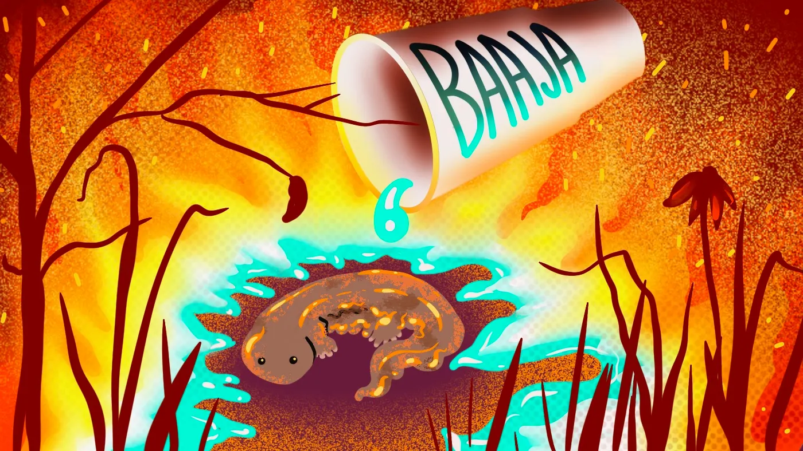
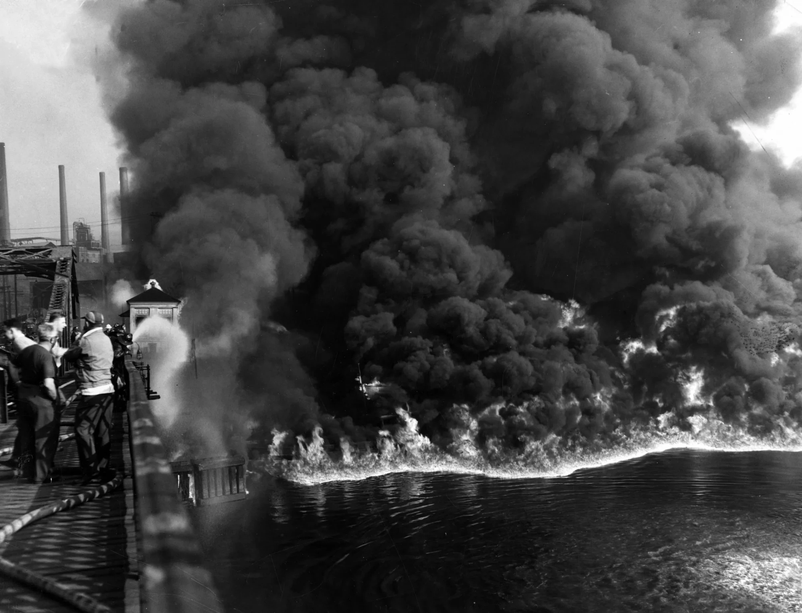

[Read this post on Medium](https://medium.com/science-policy-in-a-snap/baaja-blasts-environmental-protections-d1af50ebdc19)

Written by SNAP member [Emma Scales](https://medium.com/@emmascales)

*Thoughts and views written in this blog reflect those of the author only, and not necessarily those of every SNAP member or the SNAP coalition as a whole.*

*Footnotes are denoted with superscript. References are denoted with brackets.*

<figure style="margin: 1em 0; text-align: center;">

<figcaption style="margin-top: 0.5em; font-size: 0.875em; color: #6b6b6b; text-align: center; line-height: 1.4;">
Illustration by Emma Scales featuring the Eastern hellbender, whose status as an Endangered species is currently under contention and may be less likely to be granted under BAAJA.
</figcaption>
</figure>

**TL;DR**: BAAJA blasts environmental protections by severely limiting their authority, where and when they are applied, and the ability of local residents or local and Tribal governments to challenge harmful projects in court. Scientists need to be aware of the narrow opportunities for impactful civic engagement should BAAJA become law.

#### What is BAAJA?

The Bipartisan American Affordability and Jobs Act of 2026 (BAAJA; S. 5653) passed a final vote in the Senate on Thursday with, true to its name, bipartisan support. The bill still needs to pass a post-Thanksgiving recess House vote before becoming law, and a wide variety of advocacy groups are abuzz with shocking and conflicting claims about the contents of the bill: how they would affect energy development in the U.S., and what its passage would mean for science-informed decision making in major development projects.

This behemoth of a bill, weighing in at over 400 pages, would be consequential in likely unforeseeable ways, especially regarding environmental protections. It is well established that biodiversity loss and climate change are locked together in a downward spiral, sharing drivers and outcomes that each exacerbate the other [1,2]. If the American scientific community intends to participate in civic engagement around climate change or the invaluable ecosystem services provided by the vast biosphere that comprises the United States and the Tribal Nations, BAAJA undoubtedly merits our attention.

#### How did we get here? The roadmap to BAAJA

Division A — Committee on Environment and Public Works — has four titles:

- I: the National Environmental Policy Act of 1969 (NEPA),
- II: the Clean Water Act (CWA),
- III: the Endangered Species Act of 1973 (ESA), and
- IV: Project Certainty.

Division B — Committee on Energy and Natural Resources — has three titles:

- I: Electric Transmission,
- II: Energy Permitting, and
- III: Historic Preservation.

BAAJA is split into two Divisions representing the outcome of negotiations within two Senate committees. Division A was written by the Committee on Environment and Public Works, and Division B was written by the Committee on Energy and Natural Resources. Much of the praise for BAAJA from renewable energy advocates involves provisions set forth in the first three Titles of Division B, including speeding up the construction of new transmission lines, establishing new avenues for interstate coordination in planning larger regional transmission infrastructure, and maximizing the efficiency of existing grid capacity. These measures would hasten much-needed updates to our transmission infrastructure and allow renewable energy to power more of the grid on a faster timeline [3].

Also of note in Division B is Title III, which amends the National Historic Preservation Act to weaken Tribal consultation and review as well as protections for sacred sites or areas of cultural significance. Division B, Title IV and much of Division A have garnered intense opposition from Tribal organizations that represent nearly all sovereign Indigenous Tribal Nations [4,5]. The purview of Division B lies well outside that of my expertise and knowledge base as a biologist and conservationist, so that’s about the extent of the analysis I can offer.

Division A, though, is a truly ground-shaking rewrite of federal environmental protections, and there is more that merits consideration than can possibly be covered in one article. Nonetheless, I will point out areas that, to put it mildly, could be improved in terms of their alignment with science-informed decision making and environmental stewardship.

> **I will also flag provisions that, if enacted, will result in narrow yet critical windows for advocacy by scientists that could drastically alter outcomes for communities and ecosystems. If you read nothing else about BAAJA, read these bolded statements.**

BAAJA Division A overhauls bedrock environmental legislation to reframe legally required environmental reviews of potential project impacts as a service to corporations seeking federal permits for development, as opposed to a service to the land and the people of the United States. Under BAAJA, careful consideration of potential harms to people and the environment through weighing the best scientific evidence available would no longer make the list of priorities for agencies reviewing permit applications. Instead, the financial interests of permit sponsors would reign supreme; as a result, local residents and municipal, state, and Tribal authorities would be rendered nearly powerless to seek relief from pollution and other environmental damage through NEPA judicial review.

Before digging into Division A, it is worth noting the immense financial contributions driving legislative priorities in [post-*Citizens United* America](https://www.brennancenter.org/our-work/research-reports/fifteen-years-later-citizens-united-defined-2024-election). In the 2024 election cycle, the oil and gas industry gave over $22 million to members of the Committee on Environment and Public Works, more than double the combined donations from renewable energy, environmental, and fish and wildlife interest groups [6]. Over 99% of oil and gas industry interest groups’ giving is concentrated in majority members of the Committee, who have greater negotiating power for this session of Congress.

#### The environmental protection laws in the BAAJA blast radius

The National Environmental Policy Act (NEPA) is a landmark piece of environmental legislation passed in 1970 to safeguard environmental and public health when large projects requiring federal permits are considered. 1970 brought not only NEPA, but also the establishment of the Environmental Protection Agency (EPA), the Clean Air Act, the Endangered Species Act (ESA), and the first Earth Day [7]. This was just the first year of a decade that saw the inception of environmental regulation at the federal level, and for good reason.

<figure style="margin: 1em 0; text-align: center;">

<figcaption style="margin-top: 0.5em; font-size: 0.875em; color: #6b6b6b; text-align: center; line-height: 1.4;">
The heavily polluted Cuyahoga in Cleveland, Ohio burning in 1952, one of <a href="https://allthatsinteresting.com/the-cuyahoga-river-fire">over a dozen such fires in the river in the 20th century</a> before the curtailing of pollution under NEPA and CWA (Cleveland Press Collection/Cleveland State University Library)
</figcaption>
</figure>

At that time, toxic industrial waste was freely dumped in rivers and oceans, cities were choked with smog, and toxins like lead were abundant in everyday products. The environmental policy wave of the 1970s established the federal mandate of evaluating pollutants in the air, water, and broader environment against health-based standards [8]. Much of this momentum can be attributed to the sweeping cultural impact of popular science communication throughout the 1960s, most famously the bestselling book *Silent Spring* by marine biologist and conservationist, Rachel Carson.

NEPA is the broader bedrock law for environmental reviews, and it lays out how they should be conducted and considered, as well as the critical importance of making environmental impact statements (EIS) available to the public [9]. The Clean Water Act sets specific standards for pollutant limits by industry and type of waterway, and gives the EPA authority to regulate discharge and pollution through its permitting process [10]. The Endangered Species Act protects federally listed endangered species and their habitats, and requires consultation with the U.S. Fish and Wildlife Service (USFWS) or National Marine Fisheries Service (NMFS) before authorizing an action at the federal level that may affect endangered species, in what’s referred to as a “Section 7 review” [11]. Importantly, these laws also provide the basis for communities to file suit against the government to seek relief from projects that pollute waterways, damage habitat, or harm public health through environmental pollution.

While NEPA and its legislative contemporaries have undoubtedly improved the quality of life and habitat for all living occupants of these lands, their procedural execution has its critics. Secretary of the Interior Doug Burgum succinctly summarized industry complaints about NEPA earlier this year: “For decades, NEPA has been twisted into a weapon to block American energy, infrastructure, and conservation projects” [12]. The basis for these complaints is largely delays in construction timelines. It is worth noting that the timeline for the issuance of EIS has decreased significantly through concerted efforts under the Biden administration — from a median timeline of 3.6 years in 2019 to 2.2 years in 2024 [13].

The bulk of environmental review-associated project delays and cancellations (injunctions and vacaturs in legal-ese) arise from legal action associated with the projects. NEPA, as it’s written now, provides a broad basis for folks directly affected by these projects, as well as environmental groups, to sue the federal government to halt their construction or operation. BAAJA takes aim at both permitting timelines *and* the scope, authority, and timeline for judicial review.

#### BAAJA blasts NEPA (Division A, Title I)

BAAJA would essentially remove the intended purpose of environmental reviews as a meaningful bulwark against environmental destruction by instead crowning expediency as the highest priority. Right off the bat, BAAJA § 1102 would severely limit the kinds of projects that even require environmental review in the first place. Newly excluded would be any grant or cost-share award wherein a federal agency does not have “predominant control and responsibility” (i.e. Grants issued to private developers don’t count, except DoT grants exceeding $10M) and any loans to private companies or corporations for major development projects [11].

Where environmental review would still be required, that review would be beholden to shorter deadlines. BAAJA leaves unchanged the two-year timeline for the creation of EIS stipulated by procedural law, but requires that the lead reviewing agency render a decision within only 45 days. If this deadline is missed, the sponsor seeking authorization for a development project can petition directly to a political appointee, the Chair of the President’s Council on Environmental Quality, for a binding decision within 30 days.

BAAJA § 1106 bars reviewing agencies from delaying authorization or environmental reviews to consider new research, including findings from state entities or data brought to the attention of agencies during public comment periods [11]. This would seem to contradict BAAJA’s stipulation that “the best scientific and commercial data” be considered. **Scientists can ensure that other federal scientists and agencies conducting environmental review can access the best and most up-to-date scientific information by adhering to and advocating for principles of [open science](https://www.unesco.org/en/open-science/about) in their fields. Such practices include publishing open access pre-prints and publications, participating in open scientific reviews, and intentionally disseminating the latest findings to broader audiences.**

As stated earlier, many environmental reviews are completed within the mandated timeline of a little over two years already, so BAAJA takes its biggest swing at judicial review. Currently, the statute of limitations is six years for filing suit over issues with environmental reviews [14]. In practice, this means suits can include the harms suffered as a result of the permitted project’s operation or construction. BAAJA § 1110 would institute a 150-day statute of limitation for NEPA-related suits, with the clock beginning as soon as authorization is made public. This 150-day period would usually end long before construction is completed or even begun.

BAAJA would greatly narrow the allowable scope of the bases for these lawsuits. ***If an authorization process offered a comment period, only those who submitted a “sufficiently detailed” comment essentially predicting the harms they would suffer from the development would have standing to sue under BAAJA § 1110.*** The suit would also have to allege “an actual or imminent injury in fact amounting to a direct harm,” faced by the suing party [11]. This may greatly limit the ability of environmental groups with vast legal resources to sue on behalf of affected citizens, forcing those at risk of harm to have advanced knowledge of how that harm may occur before it does. ***This means it is more important than ever that scientists and experts be actively engaged with the civic process for developments affecting their communities. By organizing to stay aware of public comment period deadlines and sharing the scientific information people need in order to write “sufficiently detailed” comments, scientists have the opportunity to directly empower communities to protect themselves from harm.***

Further, BAAJA § 1101 would codify into law controversial jurisprudence for the entire purpose of environmental impact statements (EIS) spurred by the 2025 Supreme Court ruling in *Seven County Infrastructure Coalition v. Eagle County.* The Court’s majority opinion, authored by Justice Brett Kavanaugh, argued that “substantial deference” should be given to agencies evaluating EIS as part of their decision making process for whether or not to issue a federal permit [15]. In other words: if we, the public or as a coalition of scientists, think that a permitting agency overlooked harms considered in its environmental review and manage to sue to that effect in time and within the purview of a previously issued public comment, the presiding court may side with the agency anyway. EIS can reveal any number of harms, but ultimately under BAAJA, the agency would be entitled to “substantial deference” in its final decision of whether or not to greenlight a project.

Perhaps most troublingly, “BAAJA would make remand without vacatur the only remedy for a NEPA violation” according to the Bipartisan Policy Center. This means that a court can only order a revised environmental review, without halting the construction or the operation of the potentially harmful project at issue. A temporary injunction could only be issued if the court finds it likely that the authorization itself violates another federal law other than NEPA or the National Historic Preservation Act, and that violation must cause “irreparable harm”, AND it must be shown that pausing the authorized activity would serve the “public interest”. This adds significantly to the legal burden already faced by those filing suit for NEPA violations, and practically eliminates meaningful recourse under the statute.

#### BAAJA blasts the Clean Water Act (Division A, Title II)

Title II contains amendments to and new provisions about the Clean Water Act (CWA). BAAJA would broadly shift the burden of proof for compliance from the sponsor to the certifying federal, state, or Tribal agency. Under BAAJA § 1202, the CWA would be changed so that the certifying entity can ONLY deny certification if it provides clear & convincing evidence that no modification to the project would allow it to meet CWA requirements [11]. This essentially would require the agency to prove the negative and to have an exhaustive understanding of how a project could be modified, which is a nearly impossible task.

BAAJA § 1202 also creates an explicit carve-out from CWA compliance for interstate natural gas pipelines and transmission lines. Under this provision, only “direct point source discharge” included in the proposal could be considered for CWA violations [11], not indirect or unintended effects like the potential for pipeline leaks or increased carbon emissions.

Further, BAAJA § 1204 overhauls special CWA § 404 protections for wetlands, only allowing considerations of water quality for dredging and filling wetlands, not impacts on wildlife or other critical ecosystem services. This section also allows for anyone to discharge dredge or fill material into wetlands as long as the discharge covers two acres or less, without the need for a permit or consideration of water quality or any other environmental provision [14]. Given the interconnectedness of wetland watersheds and ecosystems, it is unclear how two acres will be quantified. BAAJA also subjects legal challenges under CWA § 404 to the same 150-day statute of limitations as NEPA challenges.

BAAJA § 1201(a) requires that new water quality criteria issued by the EPA undergo the public notice and comment rule-making procedure [11]. This will essentially delay new research-driven water quality standards and make them vulnerable to industry backlash. ***Should BAAJA pass, it will be imperative that scientists with relevant expertise contribute to these comment periods for water quality rule changes. This ensures that the best science is the main consideration in setting standards, not corporate interests.***

Though BAAJA largely guts existing protections for wetlands and waterways under CWA, states and Tribes can stipulate additional requirements for CWA compliance by passing their own regulations. **Scientists can aid local governments in understanding how current regulations may fall short in protecting their waters and the kinds of protections they could benefit from.**

#### BAAJA Blasts the Endangered Species Act (Division A, Title III)

BAAJA’s destruction of the principles underlying the Endangered Species Act (ESA) is obfuscated behind some helpful-sounding provisions like guaranteed appropriations for Section 7 review through 2031 (§ 1307) and establishing a National Fish and Wildlife Coastal State fund to “support State programs and activities intended to better understand and use coastal resources, coastal and natural infrastructure, and ecosystem services provided by natural systems” through 2032 (§ 1308). Title III, including these appropriations, represents a deliberate weakening of federal authority to protect endangered species. Currently, ESA requires the Department of the Interior, specifically the U.S. Fish and Wildlife Service (USFWS) or National Marine Fisheries Service (NMFS), to compile a biological review of a proposed project’s impact on endangered species and their habitats, referred to as Section 7 review. Title III critically allows for Section 7 review to be assigned to the states affected by the proposed action, and the § 1307–1308 appropriations advance state acquisition of ESA authority.

States with sufficient resources can already conduct Section 7 review for a very limited set of highway projects, but BAAJA would vastly expand that authority. This action is a stated policy goal of Project 2025, in order to wrench decision-making authority from U.S. Fish and Wildlife Service biologists, who are, according to the Project 2025 authors, members of “‘species cartels’ afflicted with groupthink, confirmation bias, and a common desire to preserve the prestige, power, and appropriations of the agency that pays or employs them” [16].

BAAJA does specify that states’ assumption of Section 7 review responsibilities is contingent on a determination of competency by the Secretary of the Interior. However, state governments often are financially incentivized to aid in the approval of federal permits, and staffing the smaller offices with qualified biologists and environmental scientists may be more vulnerable to political pressure and turbulence [14].

Offloading Section 7 reviews to states would allow them the same legal protections BAAJA sets forth for the federal government in challenges to federal reviews, and the Secretary of the Interior could directly intervene in any suit (§ 1304). And in case you thought this central provision of Title III was for the sake of the age-old virtue signal of “states’ rights”, if a project sponsor thinks a state review would be less favorable to them (or for any other reason), they can request USFWS or NMFS review instead. BAAJA § 1304 also contributes to its broader ethos of weakening tribal sovereignty by not specifying any obligation of states to consult with Tribal governments for Section 7 review, an obligation that is present for federal reviews.

***Critically, this provision allowing states to conduct Section 7 review would require a rule change initiated by the Secretary of the Interior with a public comment period, so this is yet another public comment period where we as a scientific community can play a vital role in protecting our communities and the environment.***

Title III also refines the definition of “best available scientific data” in the ESA to be used for listing or de-listing an endangered or at-risk species (§ 1301). According to Earthjustice, “this new language could be read to allow protection of endangered species only in cases of perfect scientific information and complete scientific certainty, which almost never exists” [14].

Once more, BAAJA institutes the 150-day statute of limitations for legal challenges under ESA.

#### BAAJA blasts blast forever & ever: Project Certainty (Division A, Title IV)

As put succinctly by the Bipartisan Policy Center in their review of BAAJA:

> *“BAAJA would bar an agency from taking any action to ‘revoke, rescind, withdraw, terminate, suspend, vacate, remand, reopen, materially amend, or materially alter’ a permit in effect on or after November 6, 2026, or from taking ‘any other action to interfere with or prevent the construction or operation at normal capacity’ of a fully permitted project with a non federal sponsor.”*

Narrow exceptions would exist for this rule, including a court order — which other BAAJA sections have made more difficult to get — or the prevention of “immediate, specific, urgent, substantial, and proximate harm” (§ 1401).

Section 1401 also allows sponsors to sue the federal government for what they perceive to be slow-walking a federal permit process, with the same penalties available as for a full termination of an active permit. BAAJA stipulates that in these suits, the burden of proof lies with the agency for showing that its actions are not arbitrary and capricious [11], a reversal of the earlier applied “substantial deference” standard for NEPA challenges of permit approval. Under BAAJA, agencies would only be entitled to a deferential standard when their position aligns with the interests of the private sponsor.

Section 1402 institutes a new kind of permitting DEI, but for corporations. This statute implies that certain industries can be discriminated against and that they are entitled to protection from such. Private companies would be able to sue a federal administration under BAAJA if their permit is denied or delayed as part of what they suspect to be a “pattern of disparate treatment” against their industry [14]. In practice, this would mean that future administrations would be unable to intentionally transition away from fossil fuel generation or infrastructure development. This enshrines the expansion of fossil fuel use in the U.S. for the foreseeable future. So much for BAAJA being the vehicle for “remarkable, rapid progress toward that goal [of clean energy dominance]” [3]…

BAAJA adds significant roadblocks to science-informed decision making and jeopardizes the broader mission of decades of environmental policy to make the United States a better steward of the ecosystems we all have the privilege of existing within. Nonetheless, an informed public is still a powerful opponent of extractive industries, unfettered greed, and those who would place shareholders over communities. Should BAAJA pass, scientists’ [social responsibility](https://doi.org/10.1128/jmbe.v15i2.870) will become all the more important. As a community, we have the opportunity, and arguably the duty, to be civically engaged around environmental issues, share specialized knowledge with the public, and use our standing as experts to advocate for the most vulnerable and the voiceless ecosystems that sustain us all.

#### Recognition:

*[Emma Scales](https://medium.com/@emmascales) is a fungal biologist and PhD candidate at Cornell University with a background in technical and journalistic writing and a passion for science communication.*

***Special thanks to the following SNAP members who provided feedback on this blog:***

*[Andrew Mattson](https://medium.com/u/a7ad9d6ba82b) is a physics PhD student developing quantum technologies for dark matter detection, gravitational wave observation, and life science/medical applications. He also serves as President of the Science Policy and Diplomacy Group at Johns Hopkins.*

*[Alex Byrne](https://medium.com/u/50e9e076a57e) received his PhD in Chemistry from the Massachusetts Institute of Technology where he studied the formation of organic molecules in interstellar environments.*

*[Alex Lando](https://medium.com/u/d412ebcc6bd3) is a Plant Pathology PhD candidate at Cornell University and co-president of the Cornell Advancing Science and Policy Club studying the use of insect-killing “zombie” fungi in agriculture.*

#### References:

1. [McElwee PD, Harrison PA, van Huysen TL, Alonso Roldán V, Barrios E, Dasgupta P, et al. IPBES Nexus Assessment: Summary for policymakers. Zenodo; 2025. doi:10.5281/ZENODO.15673657](https://doi.org/10.5281/ZENODO.15673657)
2. [Pörtner H-O, Scholes RJ, Agard J, Archer E, Arneth A, Bai X, et al. Scientific outcome of the IPBES-IPCC co-sponsored workshop on biodiversity and climate change. Zenodo; 2021. doi:10.5281/ZENODO.5101125](https://doi.org/10.5281/ZENODO.5101125)
3. [Winchester F. CCL endorses Bipartisan American Affordability and Jobs Act. In: Citizens’ Climate Lobby. 2 Oct 2026. https://citizensclimatelobby.org/blog/news/ccl-endorses-bipartisan-american-affordability-and-jobs-act/](https://citizensclimatelobby.org/blog/news/ccl-endorses-bipartisan-american-affordability-and-jobs-act/)
4. [October U, Barrington J. Nine claims about S. 5653, checked against the bill’s text. https://narf.org/wordpress/wp-content/uploads/2026/10/20261017_BAAJA_Tribes_Claim_vs_Fact_FINAL.pdf](https://narf.org/wordpress/wp-content/uploads/2026/10/20261017_BAAJA_Tribes_Claim_vs_Fact_FINAL.pdf)
5. [Affiliated Tribes of Northwest Indians, Association on American Indian Affairs, Midwest Alliance of Sovereign Tribes, National Association of Tribal Historic Preservation Officers, National Congress of American Indians, Native American Rights Fund, Rocky, Mountain Tribal Leaders Council, Tribal Self-Governance, United South and Eastern Tribes Sovereignty Protection Fund. Joint Tribal Organizations Letter Opposing BAAJA. 9 Oct 2026. https://www.usetinc.org/wp-content/uploads/2026/10/Joint-Tribal-Org-Letter-Opposing-BAAJA-NHPA-Title-FINAL-with-Logos-10_9_26.pdf](https://www.usetinc.org/wp-content/uploads/2026/10/Joint-Tribal-Org-Letter-Opposing-BAAJA-NHPA-Title-FINAL-with-Logos-10_9_26.pdf)
6. [Senate Environment and Public Works Committee Profile: Members.OpenSecrets. https://www.opensecrets.org/cong-cmtes/profiles?cmte=SENV&cycle=2024&indus=E01](https://www.opensecrets.org/cong-cmtes/profiles?cmte=SENV&cycle=2024&indus=E01)
7. [Seventies 1970–79. [cited 20 Nov 2026]. https://environmentalhistory.org/20th-century/seventies-1970-79/](https://environmentalhistory.org/20th-century/seventies-1970-79/)
8. [THE U.S. EPA’S 25TH ANNIVERSARY REPORT: 1970–1995. https://www.epa.gov/archive/epa/sites/production/files/documents/report.pdf](https://www.epa.gov/archive/epa/sites/production/files/documents/report.pdf)
9. [NEPA/CEQ. https://nepa.gov/law-and-guidance/law](https://nepa.gov/law-and-guidance/law)
10. [Holst A. Clean Water Act. Encyclopedia Britannica. 2026. https://www.britannica.com/topic/Clean-Water-Act](https://www.britannica.com/topic/Clean-Water-Act)
11. [Zeger D, Brummund M, Cowie-Haskell A, Fishman X. Explaining the Senate Permitting Bill, the Bipartisan American Affordability and Jobs Act. Bipartisan Policy Center. 2 Oct 2026. https://bipartisanpolicy.org/explainer/explaining-the-senate-permitting-bill-the-bipartisan-american-affordability-and-jobs-act/](https://bipartisanpolicy.org/explainer/explaining-the-senate-permitting-bill-the-bipartisan-american-affordability-and-jobs-act/)
12. [U.S. Department of the Interior. Trump Administration Delivers Historic NEPA Reform, Unleashing Resources on America’s Public Lands. In: U.S. Department of the Interior. 23 Feb 2026. https://www.doi.gov/pressreleases/trump-administration-delivers-historic-nepa-reform-unleashing-resources-americas](https://www.doi.gov/pressreleases/trump-administration-delivers-historic-nepa-reform-unleashing-resources-americas)
13. [ENVIRONMENTAL IMPACT STATEMENT TIMELINES (2010–2024). https://nepa.gov/sites/default/files/documents/CEQ_EIS_Timeline_Report_2025-1-13.pdf](https://nepa.gov/sites/default/files/documents/CEQ_EIS_Timeline_Report_2025-1-13.pdf)
14. [Haughey A, Miller-McFeeley B. Guide to the Impacts of the Bipartisan American Affordability and Jobs Act of 2026. Earthjustice. 20 Oct 2026. https://earthjustice.org/feature/bipartisan-american-affordability-and-jobs-act-2026-impact-guide#nepa](https://earthjustice.org/feature/bipartisan-american-affordability-and-jobs-act-2026-impact-guide#nepa)
15. [Wentz J. Seven County Infrastructure Coalition: The Supreme Court’s “Substantial Deference” Standard and Implications for Judicial Review under NEPA. Climate Law Blog. Sabin Center for Climate Change Law; 2 July 2025. https://blogs.law.columbia.edu/climatechange/2025/07/02/seven-county-infrastructure-coalition-the-supreme-courts-substantial-deference-standard-and-implications-for-judicial-review-under-nepa/](https://blogs.law.columbia.edu/climatechange/2025/07/02/seven-county-infrastructure-coalition-the-supreme-courts-substantial-deference-standard-and-implications-for-judicial-review-under-nepa/)
16. Dans P, Groves S. Mandate for leadership the conservative promise. Washington, D.C., DC: Heritage Foundation; 2023.
