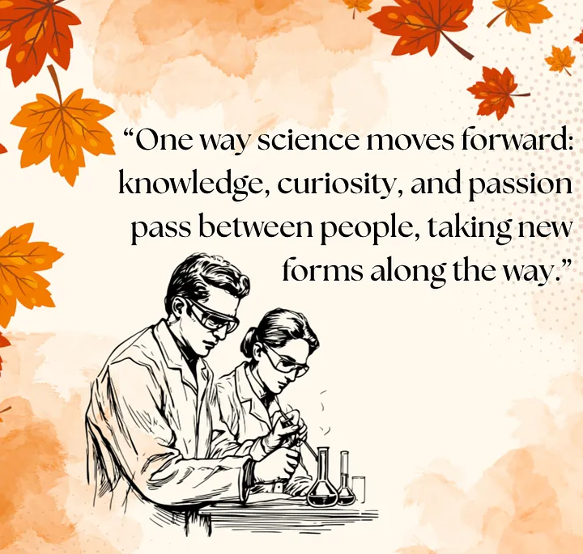

[Read this post on Medium](https://medium.com/science-policy-in-a-snap/we-couldnt-have-done-it-without-you-a-thank-you-to-the-scientists-who-inspire-us-part-1-85660be09590)

Written by SNAP members [Mikayla Smith-Craven](https://medium.com/u/3e579b1937f2) and [erin cullinane](https://medium.com/u/6de1d8d2d6c4). Both authors contributed equally to this post.

*References are denoted with brackets.*

Science, by nature, begins with curiosity, but it grows through connections. The first law of thermodynamics tells us that energy cannot be created nor destroyed, only transferred or transformed. This principle echoes in the way scientists grow; the knowledge, curiosity, and passion shared with us become the energy we bring to our own work. What we inherit from others shapes the questions we ask and the work we do together.

No research project stands entirely alone. As early career scientists, our work is shaped by the scientists and mentors, past and present, whose knowledge, encouragement, and passion continue to inspire us. Some introduced us to a field we had never considered. Others have helped us navigate an experiment that failed, challenged us to think differently, or shared an enthusiasm that became our own. Their influence continues in the research we do and in the ways we support one another. This is one way science moves forward: knowledge, curiosity, and passion pass between people, taking new forms along the way. The energy someone brings into a classroom, a lab, or a conversation can reach far beyond that moment.

This week, SNAP members are giving thanks to the scientists, mentors, and peers –past and present — whose influence has shaped our scientific lives. Through the stories below, we celebrate both their individual contributions and the collaborations and generosity that has helped science to thrive.

<figure style="margin: 1em 0; text-align: center;">

</figure>

#### Dr. Nancy Coover Andreasen

Chair of Psychiatry 
Department of Psychiatry, University of Iowa

> “Half of the human beings in history are women … but we have had so few women recognized for their genius. How many were held back by societal influences, similar to the ones I encountered and dared to ignore?” 
> — Dr. Nancy Coover Andreasen, *The Creating Brain: The Neuroscience of Genius* [1]

Born and raised in Nebraska with a passion for literature, Dr. Andreasen’s focus on science was not an immediate one. After receiving her PhD in English Literature from the University of Iowa, she contracted a severe post-partum infection after the birth of her daughter, which caused her to become interested in science and psychiatry [2]. Shortly after, she received her MD from the University of Iowa, where she conducted groundbreaking research in the field of neuroimaging, a field largely dominated by male academics at the time, as well as today.

At 88 years old, she is a recipient of the President’s National Medal of Science and is still a professor at the University of Iowa focused on neuroimaging research. Dr. Andreason serves as a beacon of hope for young potential researchers who have been told by society or the scientific community that their age, sex, gender, or other identities would prevent them from pursuing the scientific questions they wish to explore.

#### Kate the Chemist (Dr. Kate Biberdorf)

Teaching Professor; Professor for the Public Understanding of Science 
Department of Chemistry & Biochemistry, University of Notre Dame

> “It’s my belief that these younger students need more accessible STEM information in much smaller chunks … For example, the average TikTok video is 40 seconds long. If we want to use that platform to engage with the community, we need to figure out how to explain our research without jargon and with flashy visuals.” 
> — Kate Biberdorf, *Chemical and Engineering News* [3]

If you like more exhilaration and pizazz with your scientific research, then you’ll love Kate the Chemist! Kate is a certified “Science Entertainer” who has demonstrated the excitement of science experiments countless times on programs such as: The Kelly Clarkson Show, The Late Show with Stephen Colbert, The Today Show, and NBC Nightly News.

In 2024, Kate became the first-ever Professor for the Public Understanding of Science at the University of Notre Dame in Indiana. Kate demonstrates not only the importance of scientific research in our daily lives, but also the importance of connecting that science to our community members.

#### Dr. JP Flores & Ashley Eng

(JP) Postdoctoral Fellow at Case Western Reserve University 
& (Ashley) Microbiology PhD Candidate at UC Berkeley

> “Figure out what you value in your society and the people around you. Don’t let the state of science right now deter you from wanting to answer the questions that really mean something to you.” 
> — JP Flores, *AAAS Member Spotlight* [4]
>
> “It is only through the power of the people that we will restore the symbiosis between science and community.” 
> — Ashley Eng, *Brookline News* [5]

Inspiration isn’t only generated from mentors or established scientists. Inspiration can also come from our peers whose passion and dedication drive us to accomplish our goals.

Two of our fellow SNAPpers have been recognized as sparking inspiration among their peers:

1. JP Flores is a recent graduate from the University of North Carolina at Chapel Hill with a PhD in Bioinformatics and Computational Biology. He is currently a Fulbright Scholar in Milan, Italy, and will be joining Case Western Reserve University as an HHMI Gilliam Postdoctoral Research Fellow.
2. Ashley Eng is a current graduate student in the Department of Plant and Microbial Biology at the University of California — Berkeley and a self-proclaimed “proud product” of the Massachusetts public school system.

Both JP and Ashley have dedicated their free time to bringing science and research to the public through their work with SNAP, Science For Good, and many other platforms. In addition to being incredibly kind humans, they encourage their peers to get involved and are dedicated to enhancing their science communication skills to build and repair the bridge between science and society. Their dedication to scientific research and the communities impacted by their research is a true beacon of inspiration, and we are all lucky to have them as part of SNAP.

#### Dr. Ben Barres

Former Chair of Neurobiology 
Stanford University

> “I lived life on my terms: I wanted to switch genders, and I did. I wanted to be a scientist, and I was. I wanted to study glia, and I did that too. I stood up for what I believed in and I like to think I made an impact, or at least opened the door for the impact to occur.” 
> — Dr. Ben Barres, *The Autobiography of a Transgender Scientist* [6]

Dr. Barres was an advocate for inclusion in science and mentorship to develop the next generation of scientists. As an ardent supporter and advocate of equal opportunity in science, he fought for change in academia for the next generation of scientists. His article, “How to pick a graduate advisor,” gives aspiring graduate students the tools they need to set themselves up for success in their academic and scientific careers by selecting a graduate advisor who will encourage and support them through their explorations.

In addition to his dedication to helping young scientists, Dr. Barres was also a renowned scientist in neuroscience, specifically in the study of glial cells. His work with astrocytes and the role they play in synapse development within the central nervous system had a significant impact within the field. He was proud to focus on work that was ignored by most of the field, and encouraged young scientists to find the areas that lacked appreciation and research these “untouched mysteries.”

His legacy continues on, and to this day he inspires scientists to have no regrets and pursue the great mysteries of science that interest them while boosting and encouraging other scientists in the process.

#### Sir Alexander Fleming

Co-Awardee of the Nobel Prize in Physiology or Medicine (1945)

> “One sometimes finds what one is not looking for. When I woke up just after dawn on September 28, 1928, I certainly didn’t plan to revolutionize all medicine by discovering the world’s first antibiotic, or bacteria killer. But I suppose that was exactly what I did.” 
> — Sir Alexander Fleming [7]

Throwing it way back to the early 1900s, Sir Alexander Fleming’s accidental discovery of penicillin may be one of the most famous and world-changing instances of serendipity. You likely learned about the discovery of penicillin in school, but what you probably never learned about unless you studied immunology is that penicillin was not the only discovery by Fleming that occurred by chance observation.

The work of Alexander Fleming illustrates the importance of paying attention and keeping an open mind to possibilities and occurrences you never sought out. This is a key skill for scientists of all ages, but is especially important for early career researchers who can sometimes feel that they are too inexperienced to make a difference. Regardless of your age or skill level, Fleming shows us that if you keep your eyes and mind open to all possibilities, even your “failures” can change the world for the better.

#### Dr. John J. Green

Professor 
Department of Agricultural Economics, Mississippi State University

> “As a child, my dad supported all of my crazy science fair project ideas, driving me to the hardware store to buy supplies and letting me take over the garage to build things.” 
> – Edith-Marie Green; Dr. John Green’s child, now a population health scientist

A first-generation college student, Dr. John J. Green started at community college and earned his PhD by age 27. As a rural sociologist and professor at Mississippi State University, he has devoted his career to studying community development. Through community-based participatory research, he works with residents to shape the questions researchers ask about their communities. At home, that same respect for other people’s ideas showed up in trips to the hardware store and room to experiment in the garage with his children. Years later, when his child decided to pursue a PhD in population health, he was thrilled. His children admire him both for his encouragement and for how he uses research and advocacy to stand up for what he believes in.

#### Dr. Kimberly Gwinn

Professor 
Department of Entomology and Plant Pathology, University of Tennessee Institute of Agriculture (UTIA)

> “They say everything interesting happens at an interface.” 
> — Dr. Kimberly Gwinn, *The Knoxville News Sentinel* [8]

As a professor of entomology and plant pathology at the University of Tennessee Knoxville, Dr. Kimberly Gwinn studies how the compounds that plants and microorganisms produce can help protect crops from pests and disease. One practical question behind her work is whether materials left over from agriculture can be turned into biopesticides, giving growers another way to protect their crops.

Dr. Gwinn also helps aspiring scientists get their start in research. She directs Explore BiGG Data, a summer program where undergraduate women learn to use computational tools to answer questions about genetics and agriculture. Working on research projects gives students a chance to see what a career in science could look like while building skills they can bring to graduate school or their first research job. Dr. Gwinn is also the first woman to join her department’s faculty and singles out the care she shows her mentees. She makes a point of helping students build the confidence to see themselves as researchers.

#### Dr. Sarah Moses

Chaplain and Religion Faculty 
St. Stephen’s & St. Agnes School

> “The need for purpose and meaning in later life is no less important.” 
> – Dr. Sarah Moses, *The Mississippi Episcopalian* [9]

Dr. Sarah Moses, a theologian and bioethicist based in Washington, D.C., brings questions of faith and ethics to the study of aging. In Mississippi, she taught religion at the University of Mississippi while serving as an Episcopal priest, helping pioneer a model in diocese that allowed her to serve a congregation alongside her academic work. Her work in both settings asks what it takes to support people as they grow older, from the care they receive, to the roles they continue to play in their communities.

In her book *Ethics and Elderly*, Moses examines what we owe older adults who need ongoing support. In her ministry, she has encouraged congregations to make room for conversations about what gives life meaning as people age. Writing about The Path Ahead, a program she introduced to Mississippi congregations, she points to a familiar transition: retirement can change the routines and responsibilities that have given someone a sense of purpose. Through discussion, reflection, and creative activities, the program gives older adults space to explore how they want to spend their time and stay connected with others.

#### Advisors Who Go Above and Beyond

As every graduate student will tell you, your academic advisor or PI can make or break your academic experience and reinvigorate or destroy your passion for research. As early career scientists, we’d like to thank some of the advisors and mentors who have directly supported us in our journeys and inspire us to continue to encourage the next generation of scientists to come after us:

Dr. Michael J. Hageman; Dr. Amy E. Pinkham; Dr. Shane Liddelow; Dr. Doug Phanstiel; Dr. Lance Liotta; Dr. Sunny Shin; Dr. Kelly Ann Jurado; Dr. Jin Chen; Dr. Deanna Edwards; Dr. Robert J. Lee; Dr. David Kaplan; Dr. Chrystal Starbird; Dr. Orion Weiner; Sarah Jones; Dr. Teresa Pawlowska; Dr. Marissa Howard; Dr. Ilker Sarıyer; Dr. Anna Gamero; Dr. Sarah Jane Ward; Dr. Abiona Berkeley; Dr. Myles Poulin; Dr. Kacy Cullen; & Dr. Flavia Vitale

#### Conclusion

Looking back on these stories, we’re grateful for the discoveries that have changed what scientists could do and for everyday gestures that changed what we could imagine doing ourselves. A parent made room in the garage for their child’s curiosity. A professor’s class on bioethics and elder care helped a student to discover a field they did not know existed and would go on to study. Our fellow SNAPers remind us how much we learn from the people working alongside us.

To everyone we’ve celebrated here and to those we haven’t listed, thank you for sharing your curiosity, your knowledge, and your time. As early-career scientists, we carry that energy into the questions we ask and the care we bring to one another’s work. We hope to pass it on by making time for someone’s first question, helping them think through an experiment that may have failed, or encouraging them to explore a field they hadn’t considered. Someday, one of these moments might be the story they tell about how they found their way into science.

#### Recognition:

*[Mikayla Smith-Craven](https://medium.com/u/3e579b1937f2) received her doctoral degree in Pharmaceutical Chemistry from the University of Kansas where she focused on small molecule oral drug development and delivery.*

*[erin cullinane](https://medium.com/u/6de1d8d2d6c4) is a PhD candidate at Boston University studying premalignancy of lung squamous cell carcinoma.*

***Special thanks to the following SNAP members who provided feedback on this blog:***

*[Jordan Williams](https://medium.com/u/8ddae6e53e7b) is a pharmacology PhD candidate studying how to alter the lung’s innate immune responses to better treat chronic respiratory diseases.*

*[Maya Singh](https://medium.com/u/571bb49113e6) is a PhD student in bioengineering at the University of Washington. Her work focuses on creating tests to measure HIV medication levels.*

*[Sari Terrazas](https://medium.com/u/73031b32d3a3) is a molecular biology PhD candidate studying double-stranded (dsRNA) localization and dynamics in paraspeckles at UCLA.*

#### References:

1. Andreasen, Nancy C. “The Creating Brain : The Neuroscience of Genius” *The Dana Press.* **2005.**
2. Dreifus, Claudia. “Using Imaging to Look at Changes in the Brain.” *The New York Times.* 2008. [https://www.nytimes.com/2008/09/16/health/research/16conv.html](https://www.nytimes.com/2008/09/16/health/research/16conv.html)
3. Singh Chawla, Dalmeet. “What’s next for Kate the Chemist?” *Chemical & Engineering News* **102**, 34 (2024). [https://cen.acs.org/people/profiles/s-next-Kate-Chemist/102/i34](https://cen.acs.org/people/profiles/s-next-Kate-Chemist/102/i34)
4. Kirby Scammell, Alexandra. “JP Flores brings science home, connecting science to community with op-eds” *AAAS Member Spotlight*. 2025. [https://www.aaas.org/membership/member-spotlight/jp-flores-brings-science-home-connecting-science-community-op-eds](https://www.aaas.org/membership/member-spotlight/jp-flores-brings-science-home-connecting-science-community-op-eds)
5. Eng, Ashley. “‘The world stopped making sense’: How Trump’s VA cuts uprooted the life and career of a Brookline researcher.” *Brookline News*. 2025. [https://brookline.news/re-the-world-stopped-making-sense-how-trumps-va-cuts-uprooted-the-life-and-career-of-a-brookline-researcher-2/](https://brookline.news/re-the-world-stopped-making-sense-how-trumps-va-cuts-uprooted-the-life-and-career-of-a-brookline-researcher-2/)
6. Huberman, Andrew D. “Ben Barres (1954–2017) Neurobiologist who advocated for gender equality in science.” *Nature* **553**, 282 (2018). [https://doi.org/10.1038/d41586-017-08964-1](https://doi.org/10.1038/d41586-017-08964-1)
7. Haven, Kendall F. *Marvels of Science : 50 Fascinating 5-Minute Reads*. *Littleton, Colo: Libraries Unlimited,* 182 (1994)
8. Blackerby, Mike. “Group participating in 8-week research project at UT.” *Knoxville News Sentinel.* 2010. [https://archive.knoxnews.com/news/local/358653861.html/](https://archive.knoxnews.com/news/local/358653861.html/)
9. Moses, S. “Spiritually and Purpose Later in Life.” *The Mississippi Episcopalian*. 2023. [Https://Www.Msepiscopalian.Com/Wp-Content/Uploads/2024/02/TME_September__2023_FINAL_PROOF-2.Pdf](https://www.msepiscopalian.com/Wp-Content/Uploads/2024/02/TME_September__2023_FINAL_PROOF-2.Pdf)
